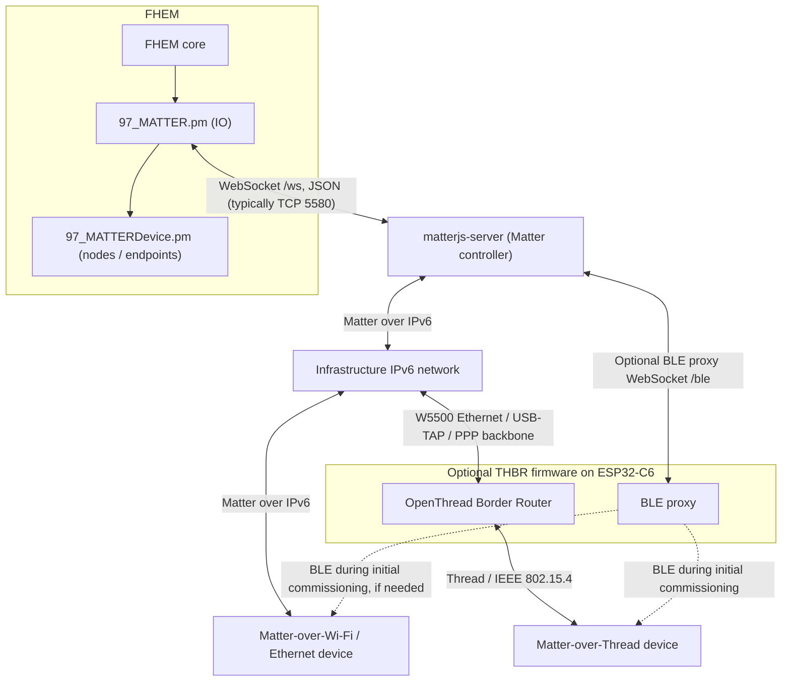

# FHEM Matter Integration (`MATTER` and `MATTERDevice`)

FHEM modules for controlling Matter devices through an **external Matter controller/server**. This repository is a fork of [Zeppelin's original FHEM Matter integration](https://gitlab.com/zeppelin1979/fhem-matter), with additional device synchronization, connection recovery, capability handling, commissioning options and FHEM updater support. The original work and its MIT license are retained; this fork is not an implementation of a Matter controller or Thread Border Router.

Two modules are installed:

- `FHEM/97_MATTER.pm`: the IO device that maintains the WebSocket/JSON connection to the controller and dispatches messages.
- `FHEM/97_MATTERDevice.pm`: logical FHEM devices representing a Matter node (root endpoint 0) and its individual endpoints.

## Architecture



The **Thread Border Router** routes IPv6 packets between the infrastructure network and the Thread mesh. The **BLE proxy** lends the ESP32-C6 Bluetooth radio to matterjs-server for initial commissioning. They are separate functions, even when running on the same board. After Thread commissioning, normal Matter communication goes through IPv6 and the Border Router, not BLE. FHEM only communicates with the Matter server.

The original [tostmann/THBR](https://github.com/tostmann/THBR) uses a host-based USB/TAP or PPP backbone. The [Flachzange/THBR-ETH fork](https://github.com/Flachzange/THBR-ETH) adds a standalone W5500 Ethernet/PoE backbone and retains the optional BLE proxy. Neither project is required for **Matter-over-Wi-Fi/Ethernet** devices that are already reachable from the Matter controller over IP. Other Thread Border Routers can provide the Thread route; this diagram illustrates the THBR deployments.

## Features

- **Connection recovery:** nonblocking IPv4 TCP/WebSocket connection; 10-second connect/upgrade deadline, Ping every 30 seconds, 15-second Pong deadline and retry 30 seconds after a failure.
- **Automatic node synchronization:** complete `start_listening` snapshot on connection/reconnection plus `node_added`, `node_updated` and `node_removed` events. Manual `discover` is still available; there is no periodic node polling.
- **FHEM device management:** optional `autocreate` (enabled by default), collision-safe root/endpoint identities, default room `Matter` for newly created devices, administrative root-node grouping, DeviceTypeList-based endpoint groups and links to endpoints in the root's FHEMWEB details. Existing names, rooms and custom groups are preserved; removed server nodes are marked rather than deleted.
- **Device commands:** exposed from the relevant Matter command/feature metadata when available, using endpoint `AcceptedCommandList` and applicable Matter feature metadata; old `has_*` settings have no effect. Mappings include on/off, color, window covering, locks, native LevelControl continuous/step dimming, Identify, Thermostat and FanControl where supported.
- **Device status and measurements:** separate `matter_status` (server membership) and `available` (server-reported reachability); device attributes are blocked while offline or availability is unknown; valid online reports resume normal snapshot and live synchronization. Readings include basic information, battery, smoke/CO, electrical metering, common environmental sensors, BooleanState contacts/leaks, Occupancy and Switch button events.
- **Network type:** root-only `networkType` reports operational Wi-Fi, Thread, Ethernet or Cellular interfaces from supplied Matter attributes, without extra requests or configuration. Multiple active types remain visible; a bridge's connection is never copied to its bridged endpoints.
- **Optional diagnostics and maintenance:** `diagnostics=1` and `rawReadings=1` are explicitly opt-in and do not trigger additional polling. ICD metadata is detected passively; compatible roots can query controller-side ICD state. Supported nodes can request a server-backed firmware update check/install without firmware upload or automatic updates.
- **Commissioning:** manual pairing codes or `MT:` QR payloads, with `network` (IP-only, default) or `auto` (IP and optionally BLE via the Matter server).
- **Native FHEM updates:** a versioned `controls_matter.txt` published on this fork's `main` branch and validated by CI.

## Requirements and security

- A running FHEM installation with Perl's `JSON` module and network access to the external Matter server.
- A Matter server providing the specific **WebSocket/JSON API** used by these modules (including `start_listening`, node events and `device_command`). The primary integration here is [matter-js/matterjs-server](https://github.com/matter-js/matterjs-server), typically listening on port 5580. A generic Python/Node.js Matter controller is **not automatically compatible** just because it uses WebSockets.
- For Matter-over-Thread: a working Thread network, an IPv6 route from the Matter controller to its devices, and Thread credentials configured on the Matter server. To commission a factory-new device via BLE, the server must have working Bluetooth support, either locally or through a compatible BLE proxy. The THBR BLE proxy requires the server's proxy feature (for example `--ble-proxy` with matterjs-server).
- **Trusted-network requirement:** `97_MATTER.pm` uses an **unencrypted, unauthenticated `ws://` connection** to `/ws`. Neither transport encryption nor authentication is implemented by the FHEM module. Keep the server API on a trusted/controlled network; do not expose it directly to untrusted networks.
- **Sensitive commands:** `commissionCode` suppresses FHEM's synthetic `set` event and redacts pairing codes from module diagnostics, but the FHEM input/history may still contain the code. The `setWifiCredentials` command now also suppresses the synthetic FHEM set event to avoid passing the password to event consumers/DbLog. **This does not secure FHEM command input/history or the unencrypted WebSocket transport**: use this operation only within a trusted, appropriately protected environment. `getCredentials` returns the server's available credential metadata, not a mechanism for configuring a Thread dataset in FHEM.

## Installation and updates

Enter the following commands in the **FHEM command line**.

1. Inspect currently registered update sources:

   ```text
   update list
   ```

2. If Zeppelin's original source appears in the list, remove it before adding the fork; FHEM will not register another source with the same `controls_matter.txt` filename, and both sources install the same module paths:

   ```text
   update delete https://gitlab.com/zeppelin1979/fhem-matter/-/raw/main/controls_matter.txt
   ```

3. Add the fork's published `main` branch:

   ```text
   update add https://raw.githubusercontent.com/Flachzange/fhem-matter-fork/main/controls_matter.txt
   ```

4. Check what this source would update:

   ```text
   update check https://raw.githubusercontent.com/Flachzange/fhem-matter-fork/main/controls_matter.txt
   ```

5. Install/update **only the Matter modules**, without updating other FHEM sources:

   ```text
   update all https://raw.githubusercontent.com/Flachzange/fhem-matter-fork/main/controls_matter.txt
   ```

   Restart FHEM after a module update to reinitialize the IO connection, timers and logical devices:

   ```text
   shutdown restart
   ```

Only merged changes on `main` are published by this source. Adding it does not automatically schedule updates, and no copying of the Perl files is needed once this source is installed. `CHANGED` provides brief notes for the current branch release; [CHANGELOG.md](CHANGELOG.md) preserves the full fork history. FHEM's updater does not maintain a separate changelog baseline per update source, so the displayed notes are not necessarily the exact delta since your last installation.

### Testing branch (optional)

The [`testing` branch](https://github.com/Flachzange/fhem-matter-fork/tree/testing) contains changes that are being evaluated before they are merged into `main`. It provides its own [FHEM updater manifest](https://raw.githubusercontent.com/Flachzange/fhem-matter-fork/testing/controls_matter.txt). Use this branch only when you intentionally want to test newer development changes.

**Automatic migration (introduced in testing V0.10):** Endpoint definitions now contain only a node ID and endpoint ID, for example `18 11`. On the first startup with the updated module, legacy definitions such as `18 11 MATTER_MatterDevice_18` are recognized and normalized **in memory**, discarding the obsolete root FHEM name. No pre-update `modify` commands are required. Existing device names, FUUIDs, readings and attributes are retained. The separate `IODev` attribute still identifies the Matter server; previously autocreated endpoints already have it.

After restarting FHEM with V0.10, **save the configuration once** using the **FHEM command line**:

```text
save
```

FHEM's normal save then writes the normalized endpoint definitions permanently, both for file-based configuration and configDB. The module does **not** automatically rewrite the configuration during startup. If no save is performed, the migration repeats on the next startup; the legacy root name is never used for device ownership. New endpoint definitions are always generated without a root-name parameter. Arbitrary extra fields remain invalid.

FHEM permits **only one update source named `controls_matter.txt`**. To switch an existing installation from this fork's `main` source to `testing`, enter the following commands in the **FHEM command line** (check your current sources with `update list` first):

```text
update delete https://raw.githubusercontent.com/Flachzange/fhem-matter-fork/main/controls_matter.txt
update add https://raw.githubusercontent.com/Flachzange/fhem-matter-fork/testing/controls_matter.txt
update check https://raw.githubusercontent.com/Flachzange/fhem-matter-fork/testing/controls_matter.txt
update all https://raw.githubusercontent.com/Flachzange/fhem-matter-fork/testing/controls_matter.txt
shutdown restart
```

To switch back to `main`, change the registered source and update the same modules from `main`:

```text
update delete https://raw.githubusercontent.com/Flachzange/fhem-matter-fork/testing/controls_matter.txt
update add https://raw.githubusercontent.com/Flachzange/fhem-matter-fork/main/controls_matter.txt
update check https://raw.githubusercontent.com/Flachzange/fhem-matter-fork/main/controls_matter.txt
update all https://raw.githubusercontent.com/Flachzange/fhem-matter-fork/main/controls_matter.txt
shutdown restart
```

Changing the registered source alone does **not** install or revert module files. The explicit `update all <source URL>` command downloads the selected branch's Matter modules; it does not update unrelated FHEM sources. Do not register the `main` and `testing` manifests simultaneously because they share the same filename and target module paths.

## Configuration and usage

### Matter IO device

Define an IO device with your Matter server's IPv4 address and its WebSocket port, using the FHEM syntax `define <name> MATTER <server-IPv4> <port>`. The example below uses a reserved documentation address; substitute the actual controller address:

```text
define matterServer MATTER 192.0.2.10 5580
```

The initial connection is **scheduled immediately for FHEM's event loop**, rather than opened during the loading of `fhem.cfg`. This prevents the 10-second TCP/WebSocket handshake deadline from expiring while FHEM is still initializing. A manual `set matterServer connect` still reconnects immediately; otherwise recovery is automatic and failed attempts are retried after 30 seconds. `attr matterServer disable 1` closes the connection and cancels its timers; removing the attribute or setting it to `0` enables reconnection. Repeated `modify` operations replace the pending startup timer without leaving duplicate connections. Prefer a numeric IPv4 address because DNS lookup may block during connection establishment. The server connection state is displayed through `state` and `ws_status`. WebSocket HTTP upgrade headers and the server's accept key are verified; fragmented text frames and interleaved control frames are handled. An inactive connection rejects FHEM device commands instead of silently discarding them. IO renaming updates the existing clients' `IODev` attributes, root routing and socket registration without creating duplicate Matter devices. Live attribute and structural node events take precedence over older outstanding read and discovery responses.

### Commission devices

Commissioning is initiated on the **MATTER IO device**, not on an individual `MATTERDevice`. The following synthetic manual code demonstrates the syntax:

```text
set matterServer commissionCode 35325335079
set matterServer commissionCode 35325335079 network
set matterServer commissionCode 35325335079 auto
```

Without the `commissionMode` attribute, an omitted mode defaults to **`network`** (IP-only). Set `attr matterServer commissionMode auto` in the FHEM command line for persistent BLE/IP discovery. Explicit `network` and `auto` arguments override the attribute for that request; `auto` permits BLE (including a connected proxy) but does not force it. A Matter QR payload beginning with `MT:` can be used instead of an 11- or 21-digit manual code.

The Matter server handles commissioning, fabric and stored Thread/Wi-Fi network credentials. The FHEM module neither stores a Thread operational dataset nor operates the BLE radio.

The MATTER IO reports `commissioning_status` (`running`, `success`, `failed` or `interrupted`), `commissioning_mode`, `commissioning_node_id`, `commissioning_duration` (seconds) and `commissioning_error`. A new attempt clears old results; one attempt per IO is permitted at a time. These readings are independent of the server connection's `state`. The server does not expose intermediate BLE/PASE commissioning phases over WebSocket. `interrupted` means the connection was lost before the outcome was received: check server nodes before trying again.

### Node synchronization and status

Newly commissioned nodes are normally imported automatically. After a reconnect the complete `start_listening` result reconciles the server node list; a manual refresh is available:

```text
set matterServer discover
```

Root devices use `DEF = <node_id>` (for example `18`); endpoints use `DEF = <node_id> <endpoint_id>` (for example `18 11`). The `IODev` attribute selects the Matter server independently of the FHEM name; a root name is never part of an endpoint DEF. This allows root and endpoint devices to be renamed without changing the technical definition. New root and endpoint devices default to FHEM room `Matter` unless manually changed later. Root devices (endpoint 0) use the shared administrative group `Matter Nodes`; functional endpoints use the name of their **single non-structural** Matter `Descriptor.DeviceTypeList` device type (for example `On/Off light`, `Electrical Sensor` for `0x0510`, or `Smoke CO Alarm`). Although Matter classifies `Electrical Sensor` as a utility type, it represents a usable measurement endpoint. Endpoints with only structural types, including `Aggregator` and `Bridged Node`, use `Matter Infrastruktur` instead of retaining a technical node group. Structural companions such as Power Source and OTA Requestor do not create additional groups. Unknown device type IDs use hexadecimal labels; multiple distinct functional device types do not trigger an arbitrary choice. Automatically generated legacy groups in the exact format `Node <node_id> (<IODev>)` migrate to these groups; custom group values are not replaced. Existing physical room assignments are never changed during synchronization. `Smoke CO Alarm` is Matter's shared device type and does not imply that a CO-only detector also detects smoke. The root detail view links to existing endpoints and shows their Matter Descriptor device types when known, otherwise a conservative cluster-based description. Every endpoint also has a persistent `associatedWith` reading linking to its owning root in FHEMWEB's native **Probably associated with** section. Existing user-added links are kept, and FHEM automatically updates root references on rename. Both relationships are matched by Matter IODev and node ID, not by FHEM naming conventions.

MATTERDevice leaves FHEM's initial `STATE` unchanged during configuration loading, allowing normal statefile restoration. Once initialization finishes, root nodes (endpoint 0) expose a native `state` reading, without an automatically configured `stateFormat` attribute: `online` for server-reported `available=true`, `offline` for `available=false`, `unknown` when no fresh reachability report is available or the MATTER IO loses its connection, and `removed` when the server removes a node or omits it from a complete node list. `online` is not inferred from mere node-list membership. The module does not introduce reachability polling. Only root `state` changes; endpoint device states remain independent and `available` retains the last raw server report, even during connection loss.

**Upgrade from V0.15:** At FHEM `INITIALIZED` / `REREADCFG`, roots that still have the old exact `stateFormat available` setting but no new-style `state` reading have that attribute removed automatically. Custom `stateFormat` values are preserved. Because V0.15 did not mark attributes as auto-created, an intentionally manually configured, identical `stateFormat available` cannot be distinguished from the old automatic default. Once migrated and a new `state` reading exists, that value can be deliberately configured again. Save the FHEM configuration after the update/restart to persist the migration.

Matter `Descriptor.DeviceTypeList` is stored per endpoint in the **`device_type_ids` reading** as canonical comma-separated hexadecimal IDs (for example `0x0011,0x0076`). Both the root detail's endpoint type labels and automatic device-type groups use this reading rather than temporary helper metadata. Once a valid DeviceTypeList has been received, FHEM restores the IDs after restart through its normal statefile or configDB handling, even when the Matter server is still disconnected. Repeated identical values do not produce additional reading events. Invalid Descriptor responses do not erase previously known IDs. For endpoints that have **never** supplied a valid DeviceTypeList, the existing cluster-based fallback is still based on currently observed runtime clusters; the fix does not invent an authoritative device type or add polling. The runtime capabilities/command metadata remains transient and is not treated as a persisted reading.

`matter_status=present` / `removed` indicates membership in the server's node list, **not** physical availability. `available=true` / `false` indicates reachability only if reported by the server. Node-wide `model` and `available` values are mirrored from the root to endpoints when known. No recurring availability poll is introduced.

### Device commands and attributes

The available commands depend on the endpoint's reported clusters and commands. Examples include `on`, `off`, `toggle`, `brightness` (device level), `pct` (percentage where supported), `ct` (mired), `rgb` (hexadecimal), `stop`, `tilt`, `lock` and `unlock`. A command appearing in the list does not guarantee it will succeed on every device.

`set <MATTERDevice> getConfig` reads attributes from the **implemented Matter clusters**, the global capability metadata and the endpoint's DeviceTypeList. It is **not** a read of all possible attributes of every Matter cluster.

Supported MATTER IO attributes include `disable:0,1`, `autocreate:0,1` (default `1`) and `commissionMode:network,auto` (default `network`). Setting `autocreate` to `0` prevents newly discovered FHEM root/endpoint devices from being created; it does not delete Matter-server nodes or stop updates to existing FHEM devices. `commissionMode` affects subsequent `commissionCode` requests without an explicit mode.

MATTERDevice attributes include `IODev`, optional `diagnostics` / `rawReadings`, `dimRate`; device limits are readings rather than attributes. Commands are offered only when the endpoint advertises them in its Matter `AcceptedCommandList` and satisfies the relevant `FeatureMap` / `ClusterRevision` constraints. Old `has_*` settings no longer enable or disable commands; they are not automatically created or deleted. After restart, control commands may be temporarily absent until the Matter server reports command metadata. **Upgrade note:** review and remove saved `has_*` attributes **before restarting into V0.18**. FHEM no longer recognizes them in the module `AttrList` and may reject those lines when restoring `fhem.cfg` or configDB. No automatic migration deletes old user settings. After the manual cleanup, save the configuration as usual.

Selecting a module-specific attribute in FHEMWEB displays its German/English
inline commandref help. Active MATTERDevice settings are `IODev`, `dimRate`,
`diagnostics` and `rawReadings`.

**V0.21 transition: device limits are readings.** The ten names
`min_brightness`, `max_brightness`, `min_frequency`, `max_frequency`,
`color_temp_min`, `color_temp_max`, `min_pin_code_length`, `max_pin_code_length`,
`min_rfid_code_length` and `max_rfid_code_length` are populated from received
device data and updated as ordinary endpoint readings. No old attribute value
is copied into a reading. The ten attribute declarations are removed entirely;
there is no compatibility or automatic migration. Review automations using
`AttrVal` and retain any old settings needed for reference: manual overrides
no longer affect controls or scaling.

**Before restarting into V0.21**, remove saved limit attributes and save the
configuration. Otherwise FHEM may reject their lines while restoring
`fhem.cfg` or configDB. Execute each line separately in the **FHEM command
line**, not in the DEF editor or a shell:

```text
deleteattr TYPE=MATTERDevice (color_temp_(min|max)|(min|max)_(brightness|frequency|pin_code_length|rfid_code_length))
save
```

This removes only the ten retired attributes from MATTERDevice devices;
readings and other attributes remain unchanged. The module does not delete
user configuration automatically.

CT and frequency controls use valid reported boundaries; when boundaries are
missing, undefined, reversed or excluded by metadata, their supported command
remains available with a text field instead of a colorpicker/slider. No 153–500
or 50–60 device range is assumed. Lighting uses the Matter maximum level 254;
other LevelControl endpoints use a usable reported maximum, with protocol
fallback 254. Brightness, percentage and RGB use the same scale. PIN/RFID lengths
are informational bytes, not a new credential-management feature. Limits obey
normal availability and response-ordering rules. Offline/unknown reports
cannot update limits or derived percentages. Online level, limit and metadata
updates may recalculate percentage from reported brightness. Readings survive ordinary
statefile/configDB restoration. No new polling or automatic reads are added.
See the embedded DE/EN commandref for per-reading details and
[protocol evidence](docs/device-limits.md) for source references and test scope.

## Known limitations

- **Window coverings:** supports basic open/close, stop, lift percentage and tilt commands when exposed by the device; not every WindowCovering-cluster function is mapped.
- **Door locks:** basic `lock`/`unlock` commands and selected readings are implemented; management of users, PINs and credentials is not implemented.
- **Thermostats / fans:** standard attributes, basic desired-temperature/mode and fan-mode/speed commands are supported when advertised. Advanced schedules, manufacturer features and unsupported writable attributes are not implemented.
- **Transport:** the FHEM IO supports an IPv4 WebSocket connection without built-in TLS or authentication; the network boundary and security requirements are described above.

## Device-level commands, ICD, network diagnostics and OTA

The root (endpoint 0) automatically exposes **`networkType`** when an accepted
`GeneralDiagnostics.NetworkInterfaces` list (`0/51/0`) arrives. Only entries
with `isOperational=true` participate:

| Reading value | Reported operational interface type |
| --- | --- |
| `wifi` | Wi-Fi |
| `thread` | Thread |
| `ethernet` | Ethernet |
| `cellular` | Cellular |
| `unknown` | No operational entry, unspecified type, or unrecognized enum value |

Multiple types are sorted and deduplicated, for example `ethernet,wifi`;
unknown active types remain visible alongside known types. The reading is
absent until the first usable list. Missing, null or malformed lists leave
the earlier value unchanged. Normal availability and response-ordering rules apply,
and unchanged values do not rewrite the reading. FHEM persists the reading
normally; its value can be cached and does not establish current reachability
or the route used by a particular Matter session. The reading stays on the
root, so a bridge's network is not attributed to its bridged devices.
`diagnostics=1` is not required, and no extra reads or timers are introduced.
Commissioning feature flags describe support and are not used to infer an
active interface. Protocol evidence and automated coverage are recorded in
[the network-type implementation notes](docs/network-type.md). Hardware
validation: **untested**.

Matter roots and endpoints expose FHEM's conventional receive internals:
`<IODev>_TIME` (last server message, local `YYYY-MM-DD HH:MM:SS`),
`LASTInputDev`, `MSGCNT` and `<IODev>_MSGCNT`. For an IO named `matterServer`,
look for `matterServer_TIME`. Each incoming message counts once for the root
and once per addressed endpoint, even with multiple attributes or unchanged
values. Mirrored root availability alone does not count as endpoint reception.
Cached/blocked snapshots and correlated replies, including server errors,
also count; this is **server reception, not a physical-device last-seen time**.
These runtime internals generate no additional reading/DbLog events and reset
on FHEM restart. An IO rename starts new fields under the new IO name while
retaining the device's total `MSGCNT` and the old IO fields, as with FHEM dispatch.

All new functionality remains within the existing FHEM root/endpoint model and
uses the external Matter server. It does not install a server, export FHEM
devices as a Matter bridge, upload firmware images or run a separate polling
engine.

- Common sensors use ordinary FHEM readings: `contact`, `water_leak`, `rain`,
  `motion`, `temperature` (°C), `humidity` (%), `illuminance` (lux),
  `pressure` (hPa), `co2`, `pm25`, `tvoc` and explicit concentration
  unit readings. Native Switch events create one FHEM event per press,
  including repeated identical presses.
- Native dimming commands: `dim_up`, `dim_down`, `dim_step_up`,
  `dim_step_down` and `dim_stop`, if the respective LevelControl commands
  are advertised. Set `attr <device> dimRate 60` for the next continuous move
  (1–254, default 30). These are device-native transitions, not FHEM timers.
- Thermostat and fan endpoints offer `desired-temp`, `mode`, `fan_mode`
  and `fan_pct` only when the corresponding standard attributes are
  advertised. The server response is correlated and a write does not
  optimistically update the device reading. Standard `identify` requires
  an advertised Identify command.
- `attr <root> diagnostics 1` enables passive Thread and Wi-Fi diagnostic
  readings, including roles, channels, neighbors and received signal levels.
  These readings exist only on the root and are not mirrored to endpoints.
  The German/English commandref's **Diagnostic readings / Diagnose-Readings**
  section in [97_MATTERDevice.pm](FHEM/97_MATTERDevice.pm)
  lists all nine readings, units, RSSI/LQI selection and freshness limits.
  Enabling diagnostics sends no request; reading timestamps advance only
  when values change, and snapshots may contain cached server data.
  `attr <endpoint> rawReadings 1` permits bounded additional readings for
  otherwise unmapped attributes. Both attributes are off by default.
  Deactivating them stops new diagnostic updates but does not delete existing
  readings. Diagnostic raw data may include device information; avoid
  exposing or logging it without understanding its content.
- ICD-capable root nodes expose static `icd_*` capabilities from reported
  attributes. A valid root `Descriptor.ServerList` (`0/29/1`) without cluster
  70 revokes previous ICD support and its commands. Omitted or malformed
  lists do not imply removal. Root `getConfig` includes ServerList in its
  existing read; newer live lists take precedence over old read/discovery
  replies. Historical mode/duration readings remain; ordinary non-ICD roots
  receive no extra negative ICD readings.
  `get <root> icdState` requires current-session OHF matterjs-server
  identification (`sdk_version=matter-server/... (matter.js/...)`) and schema
  >= 12. Check-In-capable roots on that backend can use `icdRegister`,
  `icdUnregister` or `icdResync`. Saved server readings cannot enable these
  operations after reconnect; other/unknown backends retain passive detection.
  The controller manages registration; `icd_awake=false` is not the same as
  `available=false`. Dynamic controller readings describe the last explicit
  query and keep their normal FHEM timestamps across reconnect. See
  [ICD evidence and limits](docs/icd-capabilities.md).
- Nodes with OTA Software Update Requestor support offer
  `set <root> checkFirmwareUpdate`. Only after the server reports a newer
  software version is `set <root> updateFirmware` offered. The external
  server handles lookup, downloading and delivery. No upload, automatic
  update or manufacturer's own update repository is implied. Status
  `update requested` is not proof of installation; the matching new
  software version or OTA device reports are needed.
- Device attributes and `getConfig` require current-session `available=true`.
  Unknown/offline nodes retain saved values and local corrections. IO loss,
  node removal and INITIALIZED/REREADCFG invalidate runtime availability;
  a saved `available` reading alone cannot authorize updates.
  Once a valid online report arrives, normal snapshots, `node_updated`
  attributes and live reports are accepted. No additional per-attribute event
  is required. Explicit `getConfig` can update physical values while online.
  Older read/discovery results cannot replace newer live values; requests from
  earlier availability epochs or replaced roots remain rejected.
  Missing commands after a known offline/online transition retain the bounded
  metadata-only recovery (up to three event-driven attempts, 15 seconds apart,
  no polling). Automatic metadata reads are distinct from explicit `getConfig`.
  FHEM uses the server's reported online data model, without a second per-value
  freshness policy. Rarely reporting attributes may be cached, as on the server.
  See [lifecycle behavior and evidence](docs/offline-lifecycle.md).

## Device-class hardware validation

The German and English commandref in `97_MATTERDevice.pm` explicitly marks device
classes without recorded end-to-end verification as **ungetestet / untested**.
This means the class is implemented but not independently verified on actual
hardware in this repository. Unit tests and protocol capability metadata do
not by themselves establish physical-device compatibility. Document tested
models, firmware and specific functions before changing that label.

## Development and tests

`prove -v t/matter_node_sync.t` runs modeled FHEM callback tests and WebSocket socketpair tests (including fragmented TCP delivery, large frames, node identity, capability handling, commissioning and endpoint synchronization). `.github/workflows/perl-tests.yml` runs those Perl tests in CI. The suite tests module behavior against simulated peers, not physical device behavior.

The sensor lifecycle regression for #30 covers retained/manual readings after
modeled restoration, INITIALIZED/REREADCFG, offline/online snapshots and live
reports, saved device types, renamed devices and same-node multi-IO isolation.
It checks reading write counts as well as values/timestamps. See the
[sensor acceptance matrix](docs/sensor-lifecycle.md) for covered cases and the
limits of this modeled persistence check.

The environmental measurement regression for #32 covers pressure, CO2,
PM2.5 and TVOC in snapshots and live reports, including valid zero values,
invalid/null data, separately supplied units and qualitative-only clusters.
See the [environmental measurement acceptance matrix](docs/environment-measurements.md)
for source evidence and test limits.

For module changes, run `bash make_controls.sh` and commit its updated `controls_matter.txt` alongside the changed Perl source. `bash make_controls.sh --check` and `.github/workflows/controls-matter.yml` verify the generated manifest. Its Git-blob sizes match the raw published files and its timestamps advance for changed modules, including same-size edits. Keep `CHANGED` to the current published notes and append historical changes to [CHANGELOG.md](CHANGELOG.md).

Follow [AGENTS.md](AGENTS.md) and [AGENTS-MATTER.md](AGENTS-MATTER.md) for documentation and release metadata maintenance. The existing MATTER IO `VERSION` internal identifies the module version; server/device firmware versions are separate. Changes on feature branches are not automatically published.

## License

[MIT License](LICENSE). The original project and copyright attribution are retained.
