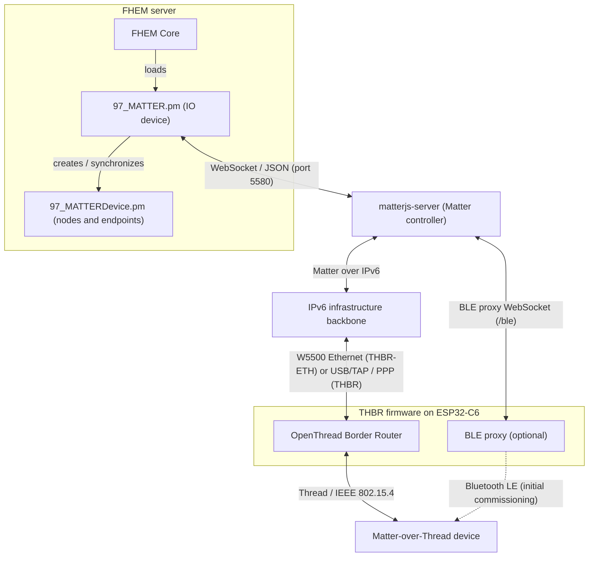

# FHEM Matter Integration (`MATTER` & `MATTERDevice`)

This repository provides custom FHEM modules to integrate **Matter** smart home devices via a central WebSocket-based Matter server. 

The architecture consists of two modules:

1. **`97_MATTER.pm` (IO-Device):** Manages the raw TCP/WebSocket connection to the Matter server, handles handshakes, keeps-alives, and routes messages.
2. **`97_MATTERDevice.pm` (Child-Device):** Represents individual Matter nodes (e.g., lights, switches), dynamically adapts its controls based on supported clusters, and synchronizes states.

---

## Architecture Overview



The ESP32-C6 can run **two distinct functions**: the OpenThread Border Router provides the IPv6 route into the Thread mesh, while the optional **BLE proxy** lends the ESP32-C6 Bluetooth radio to matterjs-server for initial commissioning. The proxy connects to the Matter server through its separate `/ble` WebSocket endpoint; FHEM does not communicate with the proxy directly. After commissioning, Matter device traffic uses IPv6 through the Border Router, **not BLE**.

The backbone connection shown above represents two alternative THBR deployments:

- **[tostmann/THBR](https://github.com/tostmann/THBR)** — original ESP32-C6 firmware with host-based USB/TAP or PPP backbone and BLE proxy.
- **[Flachzange/THBR-ETH](https://github.com/Flachzange/THBR-ETH)** — fork with standalone W5500 Ethernet/PoE backbone; its W5500 profile also includes the BLE proxy.

The BLE-proxy path requires **matterjs-server** with proxy support enabled. Compatibility with a WebSocket-based Matter server does not by itself imply that it supports the THBR BLE proxy.

---

## Prerequisites

Before setting up the FHEM modules, you need a running instance of a compatible Matter server that provides a WebSocket API, such as:

* matter-js/matterjs-server (or similar Python/Node.js based Matter controllers).

Make sure your Matter server is up and running and reachable via IP and port (default: 5580).

---

## Features

* **WebSocket Communication:** Native raw-socket handling with HTTP upgrade validation, masked client Pong responses, and JSON payload exchange. Incoming frames exceeding 32 MiB are rejected to limit memory use.
* **Automatic node synchronization:** Processes the full node list returned by `start_listening` after every successful connection/reconnect. No manual discovery is required. The `MATTER` IO attribute `autocreate:0,1` defaults to `1`. Setting it to `0` prevents new FHEM root and endpoint devices without stopping synchronization of existing devices or affecting commissioned nodes on the Matter server.
* **Live device lifecycle:** `node_added` and `node_updated` synchronize devices and endpoints. `node_removed` marks existing FHEM devices as removed without deleting their configuration.
* **Manual discovery:** `set matterServer discover` still requests a complete `get_nodes` snapshot for diagnostics or manual resynchronization.
* **Collision-safe FHEM devices:** Node identity is scoped to IODev and node ID; endpoint identity additionally includes endpoint ID. Newly created devices default to room `Matter`; existing names, rooms and attributes remain unchanged.
* **Node groups and navigation:** Root nodes and endpoints without a custom `group` attribute are grouped as `Node <node_id> (<IODev>)`. In FHEMWEB, the existing root device (endpoint 0) shows direct links to its endpoint devices.
* **Device Commissioning:** Commission using a manual setup code or Matter QR payload. The existing `network` mode (default) uses IP only; optional `auto` also permits BLE discovery through a connected BLE proxy. Stored Thread/Wi-Fi credentials remain managed by matterjs-server.
* **Dynamic Set-Lists:** Uses Matter global metadata (AcceptedCommandList, FeatureMap, AttributeList and ClusterRevision) to expose supported OnOff, LevelControl, ColorControl/CT/RGB, locking and window-covering commands. The existing `has_*` attributes remain available as a fallback before metadata arrives, and explicit `has_*=0` disables the corresponding control.
* **Additional cluster readings:** PowerSource (including battery percentage), SmokeCOAlarm, carbon-monoxide concentration, ElectricalPowerMeasurement and ElectricalEnergyMeasurement. Numerical readings use the per-attribute transformations carried forward from the feature branches; device-specific unit and firmware behavior has not been verified live.
* **Node availability:** The root node's `available` reading tracks the Matter server's reported reachability. This is independent from `matter_status` (`present`/`removed`), which only tracks server node membership.
* **RGB brightness handling:** An RGB command also sends a LevelControl level when the endpoint supports it, in addition to the hue/saturation or XY color command.
* **Auto-Reconnect:** Nonblocking TCP establishment using FHEM's writable socket callback; a 10-second TCP/WebSocket handshake deadline, WebSocket Ping every 30 seconds with a 15-second Pong deadline, and automatic reconnect every 30 seconds after failure. Pending retries and heartbeat timers are canceled when the IO is disabled or deleted.
* **FHEM Updater Support:** Seamless integration into the FHEM update mechanism.

---

## Installation & Setup

### 1. Add the Repository to FHEM
Open your FHEM command line and add this repository to your update sources:

```text
update add https://gitlab.com/zeppelin1979/fhem-matter/-/raw/main/controls_matter.txt
```

### 2. Install the Modules

Run the FHEM update command to download the files:

```text
update
```

(Restart FHEM afterward if required).

## Connection recovery

The `MATTER` IO uses a nonblocking IPv4 TCP connection and then a WebSocket upgrade. Connection and upgrade together must complete within **10 seconds**. While connected, FHEM sends a WebSocket Ping after **30 seconds**, expects the matching Pong within **15 seconds**, and repeats that cycle while the server is responsive. An unresponsive or closed socket triggers a retry after **30 seconds**, repeated until the server returns. After recovery, `start_listening` is sent again automatically; no periodic Matter-node polling is introduced.

Setting `attr matterServer disable 1` closes the connection and removes outstanding IO timers. Changing it back to `0` or deleting the attribute schedules a fresh connection. Deleting the MATTER IO device also cancels its timers. The existing `state` and `ws_status` describe the connection phase. At FHEM **verbose 2**, socket errors and timeouts include the reason; at **verbose 3**, the module logs TCP connection attempts (with count), retry scheduling, successful WebSocket connection and enable/disable transitions. Low-level connection phases and socket closes are at **verbose 4**. Routine successful Ping/Pong checks are not logged, preventing periodic log noise. Prefer a numeric IPv4 address rather than a hostname for `define`: DNS resolution itself is not asynchronous.

## Usage

### 1. Define the IO-Device

Connect to your local Matter server (default port is usually 5580):

```text
define matterServer MATTER <IP_ADDRESS> 5580
```

### 2. Commission a New Device (Optional)

The `commissionCode` command belongs to the Matter IO device (`matterServer`), not to an existing `MATTERDevice`. The default behavior is unchanged: commission a device already reachable over IP.

```text
set matterServer commissionCode 35325335079
set matterServer commissionCode 35325335079 network
```

To allow Matter-over-Thread devices that still require BLE commissioning, select `auto`:

```text
set matterServer commissionCode 35325335079 auto
```

You can also pass a Matter QR payload starting with `MT:`. `auto` permits **both BLE and IP discovery**; it does not force BLE. The matterjs-server must have Bluetooth enabled and a working local adapter or connected BLE proxy for BLE to be usable. Thread/Wi-Fi credentials must already be configured on the server. The FHEM module does not receive or store Thread operational datasets. Its logs record the chosen mode, not the setup code, and suppress the normal synthetic FHEM `set` event which would otherwise reveal the code to event consumers and DbLog. FHEM command input/history itself should still be treated as sensitive.

### 3. Node Synchronization

Newly commissioned nodes appear automatically while FHEM is connected. On connection or reconnection, the Matter server returns the complete node list in the response to `start_listening`. No manual action is required.

Manual resynchronization remains available:

```text
set matterServer discover
```

A `node_removed` event sets the `matter_status` reading to `removed` on the affected FHEM node and endpoints, **without deleting** their configuration.

`available=true/false` is taken only from a server node snapshot or `node_updated` event that explicitly contains an availability boolean. It is recorded on the root node and mirrored to its endpoints; no recurring polling is introduced. A subsequent `node_added`/`node_updated` restores `matter_status` to `present`. This reading describes server membership, **not** whether a physical device is currently reachable.

The root's `model` reading (BasicInformation on endpoint 0) is mirrored to the endpoints as well, identifying the physical device from each endpoint detail page. The module copies only `model` and `available` when the source value is known and differs from the current endpoint reading. New and existing endpoints are handled automatically; no other readings are inherited. The existing `matter_status` reading already tracks Matter server membership separately.

Each existing root `MATTERDevice` (endpoint 0) and its endpoint devices appear under the same FHEMWEB `group`, for example `Node 35 (matterServer)`, provided they have no individually configured `group` attribute. Missing groups on previously created devices are added during node synchronization even if the current snapshot contains no endpoint attributes; manual groups are not replaced. The group label incorporates the IO device name to distinguish nodes with identical IDs on different Matter servers.

In the root device's FHEMWEB detail page, **Matter endpoints** shows a compact `EP | Type | FHEM device` table with links to all existing endpoint devices. It uses plain table cells for the headings (avoiding FHEMWEB's brightly colored `th` styling). The type is taken from the endpoint's Matter Descriptor `DeviceTypeList` (cluster `0x001D`, attribute `0x0000`) when available. `getConfig` requests this list explicitly. If no device type has been reported, the UI falls back to conservative descriptions of observed clusters, such as `Temperature measurement` or `On/Off`. An OnOff cluster alone is not assumed to be a plug, light or switch. Unrecognized DeviceType IDs are shown in hexadecimal. The standard DeviceOverview remains visible and no additional FHEM devices, readings or events are created.

### 4. Control Devices

Once created, individual `MATTERDevice` instances will appear. You can control them using standard FHEM commands depending on their capabilities:

* `set <device> on / off`
* `set <device> brightness <value>`
* `set <device> ct <mireds>`
* `set <device> rgb <hex>`
* `set <device> getConfig` (Forces synchronization of all attributes)

---

## Attributes

### MATTER IO-Device

* `disable`: Temporarily disable the connection (0/1).
* `autocreate`: Default `1`. Set `attr matterServer autocreate 0` to suppress automatic creation of **new** root and endpoint devices. Existing FHEM Matter devices continue to work, and manually defined devices are unaffected. Set to `1` or remove the attribute to restore default behavior. `set matterServer discover` then discovers any missing devices without re-commissioning them.

### MATTERDevice (Child)

* `has_onoff`, `has_level`, `has_ct`, `has_hue`, `has_saturation`, `has_xy`, `has_wc`: Legacy capability flags. Existing values are retained. When the Matter server has supplied an AcceptedCommandList, advertised command support takes precedence; an explicit flag value `0` still disables that command.
* `max_level`, `color_temp_min`, `color_temp_max`: Limits for sliders and color pickers.

---

## Open Issues:

* multiple endpoints are supported, but not tested so far, as I have only devices witrh one endpoint.
* BLE-proxy-assisted commissioning is available via `commissionCode ... auto`, but a live FHEM commissioning test with a real Matter-over-Thread device is still pending.
* Window Covering (Shutters) are included but not tested
* Door locks are not supported (only some readings)
* Thermostats are not supported
* Thread and IP transport are handled by the connected Matter server and Thread Border Router, not directly by the FHEM modules.

---

## Development and tests

`prove -v t/matter_node_sync.t` runs regression tests using modeled FHEM callback side effects and a real socketpair for split WebSocket frames, including a payload over 64 KiB, availability propagation, getConfig correlation, measurement mappings and RGB command construction. The GitHub Actions workflow `.github/workflows/perl-tests.yml` installs the Perl JSON dependency and executes this test. These tests do **not** replace a live FHEM/Matter-server integration test.

The feature branch does not automatically update an installed FHEM instance. The updater configuration shown above points to the upstream GitLab repository, not this fork's feature branch.

## License

This project is open-source and provided under the MIT License.