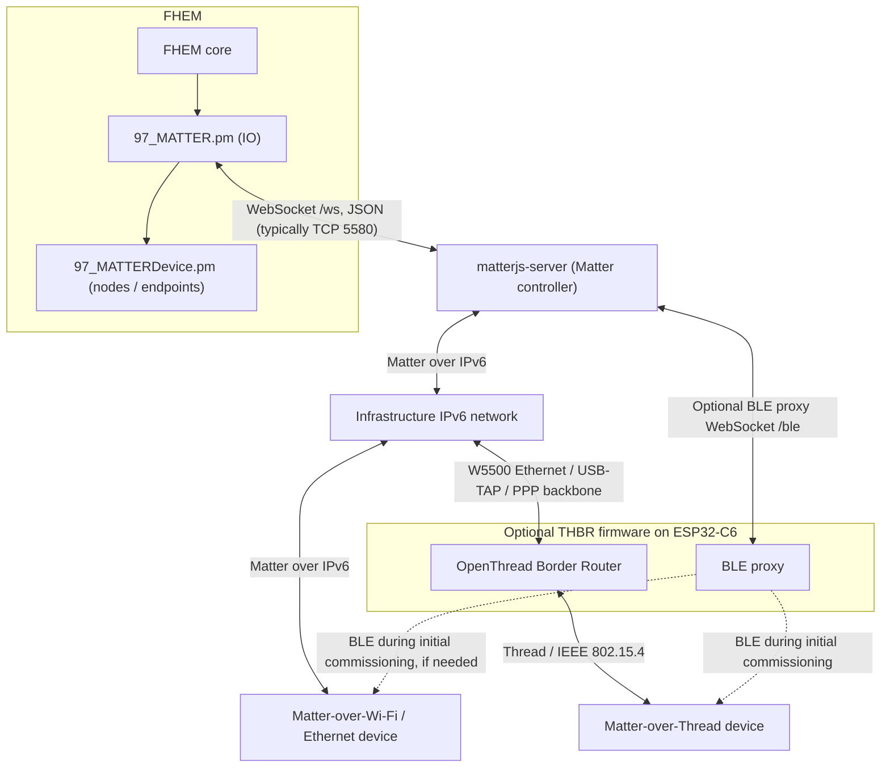

# FHEM Matter Integration (`MATTER` and `MATTERDevice`)

FHEM modules for controlling Matter devices through an **external Matter controller/server**. This repository is a fork of [Zeppelin's original FHEM Matter integration](https://gitlab.com/zeppelin1979/fhem-matter), with additional device synchronization, connection recovery, capability handling, commissioning options and FHEM updater support. The original work and its MIT license are retained; this fork is not an implementation of a Matter controller or Thread Border Router.

Two modules are installed:

- `FHEM/97_MATTER.pm`: the IO device that maintains the WebSocket/JSON connection to the controller and dispatches messages.
- `FHEM/97_MATTERDevice.pm`: logical FHEM devices representing a Matter node (root endpoint 0) and its individual endpoints.

## Architecture



The **Thread Border Router** routes IPv6 packets between the infrastructure network and the Thread mesh. The **BLE proxy** lends the ESP32-C6 Bluetooth radio to matterjs-server for initial commissioning. They are separate functions, even when running on the same board. After Thread commissioning, normal Matter communication goes through IPv6 and the Border Router, not BLE. FHEM only communicates with the Matter server.

The original [tostmann/THBR](https://github.com/tostmann/THBR) uses a host-based USB/TAP or PPP backbone. The [Flachzange/THBR-ETH fork](https://github.com/Flachzange/THBR-ETH) adds a standalone W5500 Ethernet/PoE backbone and retains the optional BLE proxy. Neither project is required for **Matter-over-Wi-Fi/Ethernet** devices that are already reachable from the Matter controller over IP. Other Thread Border Routers can provide the Thread route; this diagram illustrates the THBR deployments.

## Features

- **Connection recovery:** nonblocking IPv4 TCP/WebSocket connection; 10-second connect/upgrade deadline, Ping every 30 seconds, 15-second Pong deadline and retry 30 seconds after a failure.
- **Automatic node synchronization:** complete `start_listening` snapshot on connection/reconnection plus `node_added`, `node_updated` and `node_removed` events. Manual `discover` is still available; there is no periodic node polling.
- **FHEM device management:** optional `autocreate` (enabled by default), collision-safe root/endpoint identities, default room `Matter` for newly created devices, administrative root-node grouping, DeviceTypeList-based endpoint groups and links to endpoints in the root's FHEMWEB details. Existing names and rooms are preserved; removed server nodes are marked rather than deleted.
- **Device commands:** exposed from the relevant Matter command/feature metadata when available, using command lists for Matter commands and attribute metadata for writes; old `has_*` settings have no effect. Mappings include on/off, color, window covering, locks, native LevelControl continuous/step dimming, Identify, Thermostat and FanControl where supported.
- **Device status and measurements:** separate `matterStatus` (server membership) and `available` (server-reported reachability); device attributes are blocked while offline or availability is unknown; valid online reports resume normal snapshot and live synchronization. Readings include basic information, battery, smoke/CO, electrical metering, common environmental sensors, BooleanState contacts/leaks, Occupancy and Switch button events.
- **Network type:** root-only `networkType` reports operational Wi-Fi, Thread, Ethernet or Cellular interfaces from supplied Matter attributes, without extra requests or configuration. Multiple active types remain visible; a bridge's connection is never copied to its bridged endpoints.
- **Optional diagnostics and maintenance:** `diagnostics=1` and `rawReadings=1` are explicitly opt-in and do not trigger additional polling. ICD metadata is detected passively; compatible roots can query controller-side ICD state. Supported nodes can request a server-backed firmware update check/install without firmware upload or automatic updates.
- **Commissioning:** manual pairing codes or `MT:` QR payloads, with `network` (IP-only, default) or `auto` (IP and optionally BLE via the Matter server).
- **Native FHEM updates:** a versioned `controls_matter.txt` published on this fork's `main` branch and validated by CI.

## Requirements and security

- A running FHEM installation with Perl's `JSON` module and network access to the external Matter server.
- A Matter server providing the specific **WebSocket/JSON API** used by these modules (including `start_listening`, node events and `device_command`). The primary integration here is [matter-js/matterjs-server](https://github.com/matter-js/matterjs-server), typically listening on port 5580. A generic Python/Node.js Matter controller is **not automatically compatible** just because it uses WebSockets.
- For Matter-over-Thread: a working Thread network, an IPv6 route from the Matter controller to its devices, and Thread credentials configured on the Matter server. To commission a factory-new device via BLE, the server must have working Bluetooth support, either locally or through a compatible BLE proxy. The THBR BLE proxy requires the server's proxy feature (for example `--ble-proxy` with matterjs-server).
- **Trusted-network requirement:** `97_MATTER.pm` uses an **unencrypted, unauthenticated `ws://` connection** to `/ws`. Neither transport encryption nor authentication is implemented by the FHEM module. Keep the server API on a trusted/controlled network; do not expose it directly to untrusted networks.
- **Sensitive commands:** `commissionCode` suppresses FHEM's synthetic `set` event and redacts pairing codes from module diagnostics, but the FHEM input/history may still contain the code. The `setWifiCredentials` command now also suppresses the synthetic FHEM set event to avoid passing the password to event consumers/DbLog. **This does not secure FHEM command input/history or the unencrypted WebSocket transport**: use this operation only within a trusted, appropriately protected environment. `getCredentials` returns the server's available credential metadata, not a mechanism for configuring a Thread dataset in FHEM.

## Installation and updates

Enter the following commands in the **FHEM command line**.

1. Inspect currently registered update sources:

   ```text
   update list
   ```

2. If Zeppelin's original source appears in the list, remove it before adding the fork; FHEM will not register another source with the same `controls_matter.txt` filename, and both sources install the same module paths:

   ```text
   update delete https://gitlab.com/zeppelin1979/fhem-matter/-/raw/main/controls_matter.txt
   ```

3. Add the fork's published `main` branch:

   ```text
   update add https://raw.githubusercontent.com/Flachzange/fhem-matter-fork/main/controls_matter.txt
   ```

4. Check what this source would update:

   ```text
   update check https://raw.githubusercontent.com/Flachzange/fhem-matter-fork/main/controls_matter.txt
   ```

5. Install/update **only the Matter modules**, without updating other FHEM sources:

   ```text
   update all https://raw.githubusercontent.com/Flachzange/fhem-matter-fork/main/controls_matter.txt
   ```

   Wait until the update log confirms successful completion, then restart FHEM to reinitialize the IO connection, timers and logical devices:

   ```text
   shutdown restart
   ```

Only merged changes on `main` are published by this source. Adding it does not automatically schedule updates, and no copying of the Perl files is needed once this source is installed. `CHANGED` provides brief notes for the current branch release; [CHANGELOG.md](CHANGELOG.md) preserves the full fork history. FHEM's updater does not maintain a separate changelog baseline per update source, so the displayed notes are not necessarily the exact delta since your last installation.

### Testing branch (optional)

The [`testing` branch](https://github.com/Flachzange/fhem-matter-fork/tree/testing) contains changes that are being evaluated before they are merged into `main`. It provides its own [FHEM updater manifest](https://raw.githubusercontent.com/Flachzange/fhem-matter-fork/testing/controls_matter.txt). Use this branch only when you intentionally want to test newer development changes.

FHEM permits **only one update source named `controls_matter.txt`**. To switch an existing installation from this fork's `main` source to `testing`, enter the following commands in the **FHEM command line** (check your current sources with `update list` first):

```text
update delete https://raw.githubusercontent.com/Flachzange/fhem-matter-fork/main/controls_matter.txt
update add https://raw.githubusercontent.com/Flachzange/fhem-matter-fork/testing/controls_matter.txt
update check https://raw.githubusercontent.com/Flachzange/fhem-matter-fork/testing/controls_matter.txt
update all https://raw.githubusercontent.com/Flachzange/fhem-matter-fork/testing/controls_matter.txt
```

To switch back to `main`, change the registered source and update the same modules from `main`:

```text
update delete https://raw.githubusercontent.com/Flachzange/fhem-matter-fork/testing/controls_matter.txt
update add https://raw.githubusercontent.com/Flachzange/fhem-matter-fork/main/controls_matter.txt
update check https://raw.githubusercontent.com/Flachzange/fhem-matter-fork/main/controls_matter.txt
update all https://raw.githubusercontent.com/Flachzange/fhem-matter-fork/main/controls_matter.txt
```

For either direction, enter each command separately. FHEM normally downloads updates in the background. Once the update log confirms successful completion, restart FHEM from its command line:

```text
shutdown restart
```

Changing the registered source alone does **not** install or revert module files. The explicit `update all <source URL>` command downloads the selected branch's Matter modules; it does not update unrelated FHEM sources. Do not register the `main` and `testing` manifests simultaneously because they share the same filename and target module paths.

## Configuration and usage

### Matter IO device

Define an IO device with your Matter server's IPv4 address and its WebSocket port, using the FHEM syntax `define <name> MATTER <server-IPv4> <port>`. The example below uses a reserved documentation address; substitute the actual controller address:

```text
define matterServer MATTER 192.0.2.10 5580
```

The initial connection is **scheduled immediately for FHEM's event loop**, rather than opened during the loading of `fhem.cfg`. This prevents the 10-second TCP/WebSocket handshake deadline from expiring while FHEM is still initializing. A manual `set matterServer connect` still reconnects immediately; otherwise recovery is automatic and failed attempts are retried after 30 seconds. `attr matterServer disable 1` closes the connection and cancels its timers; removing the attribute or setting it to `0` enables reconnection. Repeated `modify` operations replace the pending startup timer without leaving duplicate connections. Prefer a numeric IPv4 address because DNS lookup may block during connection establishment. The server connection state is displayed through `state` and `ws_status`. WebSocket HTTP upgrade headers and the server's accept key are verified; fragmented text frames and interleaved control frames are handled. An inactive connection rejects FHEM device commands instead of silently discarding them. IO renaming updates the existing clients' `IODev` attributes, root routing and socket registration without creating duplicate Matter devices. Moving a root to another IO resets its reachability until the new owner reports it. An occupied target node ID is rejected. Endpoint IO assignments are independent. Live attribute and structural node events take precedence over older outstanding read and discovery responses. Explicit reads are bound to the requesting FHEM instance and endpoint; replacing or deleting it cannot redirect its reply. Renaming that same instance remains supported.

### Commission devices

Commissioning is initiated on the **MATTER IO device**, not on an individual `MATTERDevice`. The following synthetic manual code demonstrates the syntax:

```text
set matterServer commissionCode 35325335079
set matterServer commissionCode 35325335079 network
set matterServer commissionCode 35325335079 auto
```

Without the `commissionMode` attribute, an omitted mode defaults to **`network`** (IP-only). Set `attr matterServer commissionMode auto` in the FHEM command line for persistent BLE/IP discovery. Explicit `network` and `auto` arguments override the attribute for that request; `auto` permits BLE (including a connected proxy) but does not force it. A Matter QR payload beginning with `MT:` can be used instead of an 11- or 21-digit manual code.

The Matter server handles commissioning, fabric and stored Thread/Wi-Fi network credentials. The FHEM module neither stores a Thread operational dataset nor operates the BLE radio.

The MATTER IO reports `commissioningStatus` (`running`, `success`, `failed` or `interrupted`), `commissioningMode`, `commissioningNodeId`, `commissioningDuration` (seconds) and `commissioningError`. A new attempt clears old results; one attempt per IO is permitted at a time. These readings are independent of the server connection's `state`. The server does not expose intermediate BLE/PASE commissioning phases over WebSocket. `interrupted` means the connection was lost before the outcome was received: check server nodes before trying again.

### Node synchronization and status

Newly commissioned nodes are normally imported automatically. After a reconnect the complete `start_listening` result reconciles the server node list; a manual refresh is available:

```text
set matterServer discover
```

Root devices use `DEF = <node_id>` (for example `18`); endpoints use `DEF = <node_id> <endpoint_id>` (for example `18 11`). The `IODev` attribute selects the Matter server independently of the FHEM name; a root name is never part of an endpoint DEF. This allows root and endpoint devices to be renamed without changing the technical definition. New root and endpoint devices default to FHEM room `Matter` unless manually changed later. Root devices (endpoint 0) use the shared administrative group `Matter Nodes`; functional endpoints use the name of their **single non-structural** Matter `Descriptor.DeviceTypeList` device type (for example `On/Off light`, `Electrical Sensor` for `0x0510`, or `Smoke CO Alarm`). Although Matter classifies `Electrical Sensor` as a utility type, it represents a usable measurement endpoint. Endpoints with only structural types, including `Aggregator` and `Bridged Node`, use `Matter Infrastruktur` when the automatic grouping rules apply. Structural companions such as Power Source and OTA Requestor do not create additional groups. Unknown device type IDs use hexadecimal labels; multiple distinct functional device types do not trigger an arbitrary choice. Existing root groups are preserved. An endpoint group can follow a changed device type if its current name exactly matches a known type label, `Matter Infrastruktur`, or `0x` followed by four to eight uppercase hexadecimal digits. This also applies to manually assigned matching names. Other existing groups, including `Node 4 (matterServer)`, are preserved. Existing physical room assignments are never changed during synchronization. `Smoke CO Alarm` is Matter's shared device type and does not imply that a CO-only detector also detects smoke. The root detail view links to existing endpoints and shows their Matter Descriptor device types when known, otherwise a conservative cluster-based description. Every endpoint also has a persistent `associatedWith` reading linking to its owning root and, when reported, its immediate parent endpoint in FHEMWEB's native **Probably associated with** section. Existing user-added links are kept, and FHEM automatically updates those references on rename. Both relationships are matched by Matter IODev and node ID, not by FHEM naming conventions.

Normal FHEM `rename` of a root also renames its endpoints to
`<newRootName>_EP<endpoint_id>`, including individually named endpoints.
Set endpoint attribute `renameWithRoot` to `0` to keep that endpoint's name;
the default is `1`. A direct endpoint rename changes only that endpoint and
does not set the attribute automatically. Setting/deleting the attribute does
not rename a device; deletion restores the default. Roots reject the attribute.
Membership is determined by IODev and node ID, regardless of current names.
All endpoint targets are checked before any endpoint rename. On an invalid,
occupied or duplicate target, every endpoint name stays unchanged and the log
identifies the conflict; the root keeps its new name. FHEM calls `RenameFn`
after renaming the root and ignores its return value, so this is not an atomic
group transaction; unexpected errors in native callbacks may stop an already
started sequence. Attributes, IDs and physical readings remain intact; new
endpoints use the current root name. References using literal device names in
automations still need review when renaming.

MATTERDevice leaves FHEM's initial `STATE` unchanged during configuration loading, allowing normal statefile restoration. Once initialization finishes, root nodes (endpoint 0) expose a native `state` reading, without an automatically configured `stateFormat` attribute: `online` for server-reported `available=true`, `offline` for `available=false`, `unknown` when no fresh reachability report is available or the MATTER IO loses its connection, and `removed` when the server removes a node or omits it from a complete node list. `online` is not inferred from mere node-list membership. The module does not introduce reachability polling. Only root `state` changes; endpoint device states remain independent and `available` retains the last raw server report, even during connection loss.

Endpoint **STATE display** now has a device-type default, without creating a
stateFormat attribute or additional state readings. Temperature, humidity,
pressure and illumination use their existing readings with units; a combined
temperature/humidity endpoint shows both. Locks, coverings, thermostats, fans,
alarms, air-quality and electrical sensors use their own reported functional
values. On/off and binary-sensor state readings retain their existing values
and events. Button displays show `last: short` (or the last other
reported event), never an inferred actuator state. An explicit `stateFormat`
always takes precedence, including after restoration; deleting it restores
the default. Smoke/CO `alarmExpressedState`, qualitative `airQuality` and
the covering movement bitmap `wcOperationalStatus` are readable functional
readings; their defaults use those same values without a separate enum lookup.
Movement status retains global/lift/tilt fields in the existing reading.
Missing data is `unknown`; a valid numeric measurement of zero remains zero. Offline
or disabled endpoints retain their last values. Pure Aggregator/Bridged Node endpoints display current `online`/`offline`/`unknown`. Other structural/unknown types use
an existing state or `unknown`; the Flow Sensor label alone has no measurement
parser and displays `unknown`. No polling or additional Matter requests are
added. The [complete type/priority table and evidence](docs/endpoint-display.md)
cover every currently named type. Hardware behavior of these new displays is
**untested**; synthetic reports are verified with an actual local FHEM core
and FHEMWEB, including live longpoll and statefile restoration.


Matter `Descriptor.DeviceTypeList` is stored per endpoint in the **`deviceTypeIds` reading** as canonical comma-separated hexadecimal IDs (for example `0x0011,0x0076`). The **`deviceTypes` reading** additionally lists all reported types as readable names (including structural companions); unknown IDs remain hexadecimal. Utility labels include `Power Source` (`0x0011`), `OTA Requestor` (`0x0012`) and `OTA Provider` (`0x0014`). For example, `0x0012,0x0016` displays as `OTA Requestor, Root node`; this does not indicate an available firmware update. Both the root detail's endpoint type labels and automatic device-type groups use `deviceTypeIds` rather than temporary helper metadata. Once a valid DeviceTypeList has been received, FHEM restores the IDs after restart through its normal statefile or configDB handling, even when the Matter server is still disconnected. Repeated identical values do not produce additional reading events. Invalid Descriptor responses do not erase previously known IDs. For endpoints that have **never** supplied a valid DeviceTypeList, the existing cluster-based fallback is still based on currently observed runtime clusters; the fix does not invent an authoritative device type or add polling. The runtime capabilities/command metadata remains transient and is not treated as a persisted reading.

`matterStatus=present` / `removed` indicates membership in the server's node list, **not** physical availability. Ordinary endpoints inherit the root's `available=true` / `false`; bridged devices and their functional endpoints use effective `available=true` / `false` / `unknown` as described below. The root's `model` is mirrored when known. No recurring availability poll is introduced.

Bridge endpoint processing (**hardware untested**, automated callback and actual-FHEM coverage):

- Descriptor `PartsList` determines a unique direct **`parentEndpoint` internal**. Full-family lists include descendants and are reduced accordingly; missing/ambiguous relationships are not guessed from endpoint numbers. `device` remains the root name. Relationships are refreshed on valid structure reports, scoped to the same IO and node.
- Native `associatedWith` links include root and direct parent. Previously module-owned parent links are replaced when composition changes; unrelated user links remain. Hidden `.matterParent` persists the owned parent's numeric endpoint ID so cleanup still works after rename/save/restart. Existing user links are reused without claiming ownership. No new rename cascade or room-tree renderer is introduced.
- Cluster `0x0039` (*Bridged Device Basic Information*), attribute `0x0011` (*Reachable*) describes each bridged device. Root offline or any enclosing bridged device unreachable means effective offline. Online requires root online and all enclosing Reachable values true; missing fresh reachability means unknown. IO invalidation/root offline clears runtime bridged reachability; saved readings never authorize updates.
- Physical telemetry and button events remain unchanged while the bridged device is offline/unknown. Descriptor, capability and bridged metadata can still update while the root is online, enabling recovery without polling. Older read responses cannot replay physical data across a bridged availability cycle. Local endpoint disable remains effective; structural PartsList processing stays active.
- Pure Aggregator/Bridged Node endpoints display `online`/`offline`/`unknown` through the existing default display policy. Functional companion types retain priority, including `on`/`off`; explicit `stateFormat` overrides are preserved. Infrastructure grouping remains unchanged.
- Existing `getConfig` reads include each endpoint's PartsList and Reachable; no new automatic query is introduced. See [endpoint model and protocol evidence](docs/endpoint-display.md).

Changing the actual IO instance, node ID or endpoint ID discards the old runtime permissions and firmware offers. Control-relevant saved metadata (device types, ICD permissions, software/specification versions and reported limits) must be reported for the new identity; other saved physical readings and local policy remain. Renaming the same instance or confirming an unchanged DEF preserves its permissions. An occupied root target is rejected before a modify changes internal state.

### Device commands and attributes

The available commands depend on the endpoint's reported clusters and commands. Examples include `on`, `off`, `toggle`, `brightness` (device level), `pct` (percentage where supported), `ct` (mired), `rgb` (hexadecimal), `stop`, `tilt`, `lock` and `unlock`. A command appearing in the list does not guarantee it will succeed on every device.

`set <MATTERDevice> getConfig` reads attributes from the **implemented Matter clusters**, the global capability metadata and the endpoint's DeviceTypeList. It is **not** a read of all possible attributes of every Matter cluster.

Supported MATTER IO attributes include `disable:0,1`, `autocreate:0,1` (default `1`) and `commissionMode:network,auto` (default `network`). Setting `autocreate` to `0` prevents newly discovered FHEM root/endpoint devices from being created; it does not delete Matter-server nodes or stop updates to existing FHEM devices. `commissionMode` affects subsequent `commissionCode` requests without an explicit mode.

Only values accepted by the shared attribute conversion can supersede an outstanding read/discovery path; rejected sensor sentinels, limits or diagnostic data leave useful response values eligible.

A malformed capability list preserves the previous valid list for that endpoint and cluster. An explicit empty list clears its entries. Omitted paths in a partially successful getConfig reply retain prior metadata; a valid Descriptor.ServerList explicitly removes clusters absent from that list. Endpoint getConfig reads ServerList as well as DeviceTypeList. Newer structural lists take precedence over delayed read/discovery data.

MATTERDevice attributes include `IODev`, `readOnly:0,1` / `disable:0,1`, endpoint `renameWithRoot:0,1`, optional `diagnostics` / `rawReadings`, `dimRate`; device limits are readings rather than attributes. Cluster commands such as `on` and `identify` require an entry in the endpoint’s `AcceptedCommandList` and any applicable features. Attribute writes such as `desired-temp` and `fanPct` use the endpoint’s attribute and feature metadata. The `mode` and `fanMode` choices also depend on the reported sequence. The module records the reported `ClusterRevision` as metadata. Set commands advertised as `noArg` reject additional arguments before sending. Old `has_*` settings no longer enable or disable commands; they are not automatically created or deleted. After restart, control commands may be temporarily absent until the Matter server reports command metadata. **Upgrade note:** review and remove saved `has_*` attributes **before restarting into V0.18**. FHEM no longer recognizes them in the module `AttrList` and may reject those lines when restoring `fhem.cfg` or configDB. No automatic migration deletes old user settings. After the manual cleanup, save the configuration as usual.

Selecting a module-specific attribute in FHEMWEB displays its German/English
inline commandref help. Active MATTERDevice settings are `IODev`, `readOnly`, `disable`, `renameWithRoot`, `dimRate`,
`diagnostics` and `rawReadings`.

**Endpoint control protection:** `readOnly:0,1` defaults to `0`. Set
`readOnly=1` on a functional endpoint to block all its control commands and
attribute writes from FHEM, including automation calls, Identify and Stop.
The set list then offers only `getConfig`; direct control calls return an
explicit error. Readings, events, receive internals and capability reads
continue normally. Setting `0` or deleting the attribute restores the current
capability-based controls without another read or replaying blocked commands.
Already-sent commands retain normal completion handling; enabling protection
between compound command components blocks only the unsent remainder.
Roots reject the attribute and do not propagate it. Other endpoints,
root administration, other Matter controllers, direct server access and physical
buttons remain independent. This is protection against accidental FHEM control,
not a guarantee that an actuator stays on.

**Pause an endpoint:** `disable=1` stops its FHEM commands (including getConfig),
functional readings, capability updates, mirrored status and button events.
Existing readings/timestamps and device identity remain intact. Root association
and receive internals continue; root, siblings and the server remain active.
Pending endpoint requests are discarded locally. Outstanding shared reads and
discovery replies exclude the endpoint, even after re-enabling. Already-sent
commands cannot be recalled. `disable=0` or deleting the attribute resumes
processing and requests endpoint getConfig once if connected and online;
otherwise normal online synchronization resumes later. No polling or command
replay is added. The attribute defaults to `0`, is rejected on roots, and does
not change `readOnly`. No Matter radio traffic reduction is promised.

Device-reported endpoint limits are readings, not configurable attributes:
`minBrightness`, `maxBrightness`, `minFrequency`, `maxFrequency`,
`colorTempMin`, `colorTempMax`, `minPinCodeLength`,
`maxPinCodeLength`, `minRfidCodeLength` and `maxRfidCodeLength`.
They reflect accepted Matter reports and do not act as local command overrides.

CT and levelFrequency controls use valid reported boundaries; when boundaries are
missing, undefined, reversed or excluded by metadata, their supported command
remains available with a text field instead of a colorpicker/slider. No 153–500
or 50–60 device range is assumed. Lighting uses the Matter maximum level 254;
other LevelControl endpoints use a usable reported maximum, with protocol
fallback 254. Brightness, percentage and RGB use the same scale. PIN/RFID lengths
are informational bytes, not a new credential-management feature. Limits obey
normal availability and response-ordering rules. Offline/unknown reports
cannot update limits or derived percentages. Online level, limit and metadata
updates may recalculate percentage from the reported native dimmer level. Readings survive ordinary
statefile/configDB restoration. No new polling or automatic reads are added.
See the embedded DE/EN commandref for per-reading details and
[protocol evidence](docs/device-limits.md) for source references and test scope.

## Consistent reading names (V0.44)

Module-specific readings follow lowerCamelCase. These include device metadata,
limits, alarm details, commissioning, server status, firmware/ICD and network
diagnostics. Examples are `batteryChargeLevel`, `batteryCapacity` (mAh),
`batteryTimeRemaining` (s), `deviceTypeIds`, `deviceTypes`, `firmwareUpdate`, `fanMode`,
`fanPct`, `threadRole`, `wifiRssi` and `commissioningStatus`.
Native FHEM names retain their spelling: `IODev`, `associatedWith`, `state`,
`measured-temp`, `desired-temp` and `desired-temp-cool`. Wire/API fields and
enum values remain unchanged. Dynamic raw readings use
`rawEp<endpoint>Cluster<cluster>Attribute<attribute>`; credential metadata
uses `wifi<id>Ssid`, `thread<id>Name` and `thread<id>ExtPanId`.
See [the reading contract](docs/reading-conventions.md) for units and scope.

## Functional readings (V0.42, #91)

Battery readings are `batteryPercent`, `batteryVoltage` (V) and `batteryState`
(ok/low). ColorControl uses `ct` (mired), `hue` and `sat` (native 0–254).
Sensors report `brightness` in lux. Coverings use `pct` (100=open, 0=closed)
and native `tilt` percent; the pct setter uses the same percent-open direction.
Locks provide textual `state`. Electrical `frequency` is Hz with exactly three
decimal places (e.g. `50.000`, `49.987`, `0.050`); LevelControl
uses `levelFrequency` for its independent native frequency reading and setter.

Ordinary dimmers use `brightness` (0–254) and `pct` (0–100). With illuminance
on the same endpoint, native dimmer reading/setter uses `level`; with covering,
dim percent uses `dimmerPct`. The hidden `.matterReadingSources` persists the
necessary source provenance without authorizing commands or emitting events.
See [functional names, units, collision policy and evidence](docs/reading-conventions.md).
No additional reads or polling. Hardware validation: **untested**.

## Known limitations

- **Window coverings:** supports basic open/close, stop, lift percentage and tilt commands when exposed by the device; the endpoint readings `physicalClosedLimitLift` and `physicalClosedLimitTilt` contain the last reported physical limits when available.
- **Door locks:** basic `lock`/`unlock` commands and selected readings are implemented; management of users, PINs and credentials is not implemented.
- **Thermostats / fans:** standard attributes, basic desired-temperature/mode and fan-mode/speed commands are supported when advertised. Advanced schedules, manufacturer features and unsupported writable attributes are not implemented.
- **Transport:** the FHEM IO supports an IPv4 WebSocket connection without built-in TLS or authentication; the network boundary and security requirements are described above.

## Device-level commands, ICD, network diagnostics and OTA

The root (endpoint 0) automatically exposes **`networkType`** when an accepted
`GeneralDiagnostics.NetworkInterfaces` list (`0/51/0`) arrives. Only entries
with `isOperational=true` participate:

| Reading value | Reported operational interface type |
| --- | --- |
| `wifi` | Wi-Fi |
| `thread` | Thread |
| `ethernet` | Ethernet |
| `cellular` | Cellular |
| `unknown` | No operational entry, unspecified type, or unrecognized enum value |

Multiple types are sorted and deduplicated, for example `ethernet,wifi`;
unknown active types remain visible alongside known types. The reading is
absent until the first usable list. Missing, null or malformed lists leave
the earlier value unchanged. Normal availability and response-ordering rules apply,
and unchanged values do not rewrite the reading. FHEM persists the reading
normally; its value can be cached and does not establish current reachability
or the route used by a particular Matter session. The reading stays on the
root, so a bridge's network is not attributed to its bridged devices.
`diagnostics=1` is not required, and no extra reads or timers are introduced.
Commissioning feature flags describe support and are not used to infer an
active interface. Protocol evidence and automated coverage are recorded in
[the network-type implementation notes](docs/network-type.md). Hardware
validation: **untested**.

Matter roots and endpoints expose FHEM's conventional receive internals:
`<IODev>_TIME` (last server message, local `YYYY-MM-DD HH:MM:SS`),
`LASTInputDev`, `MSGCNT` and `<IODev>_MSGCNT`. For an IO named `matterServer`,
look for `matterServer_TIME`. Each incoming message counts once for the root
and once per addressed endpoint, even with multiple attributes or unchanged
values. Mirrored root availability alone does not count as endpoint reception.
Cached/blocked snapshots and correlated replies, including server errors,
also count; this is **server reception, not a physical-device last-seen time**.
These runtime internals generate no additional reading/DbLog events and reset
on FHEM restart. An IO rename starts new fields under the new IO name while
retaining the device's total `MSGCNT` and the old IO fields, as with FHEM dispatch.

All new functionality remains within the existing FHEM root/endpoint model and
uses the external Matter server. It does not install a server, export FHEM
devices as a Matter bridge, upload firmware images or run a separate polling
engine.

- Common sensors use ordinary FHEM readings: `contact`, `waterSensor`, `rain`,
  `motion`, `temperature` (°C), `humidity` (%), `brightness` (lux),
  `pressure` (hPa), `co2`, `pm25`, `tvoc` and explicit concentration
  unit readings. Native Switch events create one FHEM event per press,
  including repeated identical presses.
- Native dimming commands: `dim_up`, `dim_down`, `dim_step_up`,
  `dim_step_down` and `dim_stop`, if the respective LevelControl commands
  are advertised. Set `attr <device> dimRate 60` for the next continuous move
  (1–254, default 30); the commands themselves take no arguments. Steps use
  20 native level units with transition time zero. The regular command is
  preferred; the WithOnOff variant is used only if it is the advertised
  alternative and may also affect OnOff state. OptionsMask/Override remain
  zero, leaving the endpoint's configured options in effect.
  These are device-native transitions, not FHEM timers. See
  [native dimming](docs/native-dimming.md).
- All device commands and attribute writes use one shared request path:
  on/off, color/level, coverings, locks, Identify, dimming and HVAC setters.
  Each API request retains its own message_id until reply, timeout or IO loss.
  Commands and writes can overlap; a pending response does not lock Stop or
  the next write. Only the latest setter changes the endpoint's `lastError`;
  older replies are still correlated and retired. RGB's level/color requests
  share one result so a successful component cannot conceal a failed one.
  Device commands accept successful replies with any result value;
  attribute writes validate returned Matter status/path lists, preserving null
  API acknowledgements. Neither updates physical readings. Missing or invalid
  replies, server refusal, timeout and IO loss are reported as errors/unknown
  outcomes. Existing OTA/ICD policies use the same transport registry with
  their existing administrative serialization and status readings.
  See [request correlation and evidence](docs/device-requests.md).
- Thermostat endpoints offer `desired-temp` (heating) and `desired-temp-cool`
  (cooling) from advertised writable attributes and the corresponding features.
  Celsius text inputs accept up to two decimals, without an arbitrary 5–30 °C
  widget range; the device checks its actual limits. `mode` uses thermostat
  features plus ControlSequenceOfOperation; `fanMode` uses FanModeSequence
  plus Auto support. Mode lists require the supplied sequence metadata and
  do not infer capabilities from current values. Normal snapshots or explicit
  `getConfig` supply it, without extra probes. Optional thermostat enum support
  and controller ACLs remain device decisions.
  `fanPct` writes PercentSetting, distinct from the reported PercentCurrent.
  Setter validation uses the same metadata as FHEMWEB. A correlated status
  reply must match the written path; nonzero Matter status or malformed replies
  appear in `lastError`. Existing null API acknowledgements remain accepted.
  Neither acknowledgement updates physical readings. Standard `identify`
  still requires an advertised command. See [HVAC write evidence](docs/hvac-writes.md).
- `attr <root> diagnostics 1` enables passive Thread and Wi-Fi diagnostic
  readings, including roles, channels, neighbors and received signal levels.
  These readings exist only on the root and are not mirrored to endpoints.
  The German/English commandref's **Diagnostic readings / Diagnose-Readings**
  section in [97_MATTERDevice.pm](FHEM/97_MATTERDevice.pm)
  lists the readings, units, RSSI/LQI selection and freshness limits.
  `threadExtAddress` exposes the own Thread address as 16 hex digits;
  `threadRloc16` exposes the own reported routing locator (decimal).
  Neighbor addresses use hex and resolve to current FHEM root names only
  when accepted diagnostic identities match uniquely on the same IO and
  Thread ExtendedPanId. Both roots need `diagnostics=1`. Unknown peers,
  including Border Routers without a known Matter root, retain their address.
  End devices and REEDs with a valid child locator can mark a unique parent
  from Rloc16; routers/leaders have no general active neighbor. The strongest
  RSSI is not the parent selection. Later metadata and native rename/delete
  can reformat a cached list without a new neighbor report. See
  [Thread neighbor evidence and limits](docs/thread-neighbors.md).
  The root detail page also shows a **Thread neighbors** table with clickable
  known FHEM root names, role/parent and RSSI. This table appears only with
  `diagnostics=1` and accepted usable neighbor data, including on roots
  without endpoints. Unknown or ambiguous neighbors remain plain addresses.
  Both detail tables keep their full-width theme frame while their data
  columns use content width; the remaining space stays empty on the right.
  The reading stays plain text for events, logging and JSON consumers.
  The table is rendered when opening/reloading the detail page; it adds no
  polling or background refresh. Disabling diagnostics hides the table on
  the next page load even though existing readings are retained.
  Enabling diagnostics sends no request; reading timestamps advance only
  when values change, and snapshots may contain cached server data.
  `attr <endpoint> rawReadings 1` permits bounded additional readings for
  otherwise unmapped attributes. The raw filter skips null values, attribute
  IDs at or above 0xFFF0 and clusters 31, 48, 49, 60, 62, 63, 64 and 65
  (decimal). The per-value limit is 512 characters for scalar text or 512
  bytes for JSON-encoded structures. Both attributes are off by default.
  Deactivating them stops new diagnostic updates but does not delete existing
  readings. Unknown and vendor-specific attributes can expose private device
  information in readings and logs.
- ICD-capable root nodes expose static `icd…` capabilities from reported
  attributes. A valid root `Descriptor.ServerList` (`0/29/1`) without cluster
  70 revokes previous ICD support and its commands. Omitted or malformed
  lists do not imply removal. Root `getConfig` includes ServerList in its
  existing read; newer live lists take precedence over old read/discovery
  replies. Historical mode/duration readings remain; ordinary non-ICD roots
  receive no extra negative ICD readings.
  `get <root> icdState` requires current-session OHF matterjs-server
  identification (`sdkVersion=matter-server/... (matter.js/...)`) and schema
  >= 12. Check-In-capable roots on that backend can use `icdRegister`,
  `icdUnregister` or `icdResync`. Saved server readings cannot enable these
  operations after reconnect; other/unknown backends retain passive detection.
  The controller manages registration; `icdAwake=false` is not the same as
  `available=false`. Dynamic controller readings describe the last explicit
  query and keep their normal FHEM timestamps across reconnect. See
  [ICD evidence and limits](docs/icd-capabilities.md).
- Roots reporting the OTA Requestor cluster expose
  `checkFirmwareUpdate` after the current server handshake identifies
  matterjs-server (schema 11+) or Python Matter Server (schema 10+).
  Both commands remain available under their usual prerequisites when FHEM
  shows the root as offline. The server decides whether it can fulfill the request.
  Before the first check, an absent status means unknown. A check returning
  `none reported` says only that this server supplied no offer. A manufacturer
  app may have other updates. Local server settings can also disable OTA.
  `updateFirmware` consumes the offered uint32 version. A matching device
  SoftwareVersion confirms installation, including when the server reply
  arrives later. Progress readings are optional. Timeout or server disconnect
  requires a fresh manual check. The server handles image delivery.
- Device attributes and `getConfig` require current-session `available=true`.
  Unknown/offline nodes retain saved values and local corrections. IO loss,
  node removal and INITIALIZED/REREADCFG invalidate runtime availability;
  a saved `available` reading alone cannot authorize updates.
  Once a valid online report arrives, normal snapshots, `node_updated`
  attributes and live reports are accepted. No additional per-attribute event
  is required. Explicit `getConfig` can update physical values while online.
  Older read/discovery results preserve newer values reported via `attribute_updated` or
  `node_updated` for each affected path; requests from
  earlier availability epochs or replaced roots remain rejected.
  Missing commands after a known offline/online transition retain the bounded
  metadata-only recovery (up to three event-driven attempts, 15 seconds apart,
  no polling). Automatic metadata reads are distinct from explicit `getConfig`.
  FHEM uses the server's reported online data model, without a second per-value
  freshness policy. Rarely reporting attributes may be cached, as on the server.
  See [lifecycle behavior and evidence](docs/offline-lifecycle.md).

The cumulative `energy` reading validates the inner named/TLV struct field as an integer in the specified 0–2^62 mWh range before converting to kWh. Invalid or missing data preserves the last value; numeric zero remains valid.

## Device-class hardware validation

The German and English commandref in `97_MATTERDevice.pm` explicitly marks device
classes without recorded end-to-end verification as **ungetestet / untested**.
This means the class is implemented but not independently verified on actual
hardware in this repository. Unit tests and protocol capability metadata do
not by themselves establish physical-device compatibility. Document tested
models, firmware and specific functions before changing that label.

## Development and tests

`prove -v t/matter_node_sync.t` runs modeled FHEM callback tests and WebSocket socketpair tests (including fragmented TCP delivery, large frames, node identity, capability handling, commissioning and endpoint synchronization). `.github/workflows/perl-tests.yml` runs those Perl tests in CI. The suite tests module behavior against simulated peers, not physical device behavior.

The disable regression for #78 covers frozen readings/capabilities/events,
explicit and shared stale replies across both transitions, normal sibling/root
processing, one-shot online activation, passive offline activation, restoration,
rename, readOnly interaction, compound cancellation and node-removal detection.

The readOnly regression for #77 covers all existing endpoint setter families,
internal command/write callers, compound sends, explicit/automatic reads,
continued reports/events, completion of prior commands, attribute restoration,
and endpoint/multi-IO isolation. Tests model FHEM callbacks and server replies;
live FHEM/configDB and hardware validation remain **untested**.

The sensor lifecycle regression for #30 covers retained/manual readings after
modeled restoration, INITIALIZED/REREADCFG, offline/online snapshots and live
reports, saved device types, renamed devices and same-node multi-IO isolation.
It checks reading write counts as well as values/timestamps. See the
[sensor acceptance matrix](docs/sensor-lifecycle.md) for covered cases and the
limits of this modeled persistence check.

The environmental measurement regression for #32 covers pressure, CO2,
PM2.5 and TVOC in snapshots and live reports, including valid zero values,
invalid/null data, separately supplied units and qualitative-only clusters.
See the [environmental measurement acceptance matrix](docs/environment-measurements.md)
for source evidence and test limits.

The root/endpoint rename regression (#101) runs through the actual pinned FHEM
core in both encodings. It covers native callbacks/events, protected and manual
names, collisions, IO isolation, routing and save/rereadcfg. Modeled callbacks
also cover pending commands and reads across automatic endpoint rename. External
Matter server/hardware and configDB validation remain **untested**.

For module changes, run `bash make_controls.sh` and commit its updated `controls_matter.txt` alongside the changed Perl source. `bash make_controls.sh --check` and `.github/workflows/controls-matter.yml` verify the generated manifest. Its Git-blob sizes match the raw published files and its timestamps advance for changed modules, including same-size edits. Keep `CHANGED` to the current published notes and append historical changes to [CHANGELOG.md](CHANGELOG.md).

Follow [AGENTS.md](AGENTS.md) and [AGENTS-MATTER.md](AGENTS-MATTER.md) for documentation and release metadata maintenance. The modules have independent versions, shown in the native `FVERSION` internal:

| FHEM device | Module version shown |
| --- | --- |
| MATTER IO | `97_MATTER.pm` |
| Every MATTERDevice root and endpoint, including offline devices | `97_MATTERDevice.pm` |

All MATTERDevice instances share the same module version. `FVERSION` reflects the loaded code after definition or module reload; server/device firmware versions remain separate. Only functionally changed modules receive a version/date increase; documentation-only and tests-only changes do not. Both modules start this scheme at V0.48 (27.11.2026) and continue to be distributed and tested together through the same update source. Different module versions do not imply that arbitrary historical combinations are compatible. The actual-core regression suite covers independent version changes, reload, redefine and rereadcfg without a Matter server. Changes on feature branches are not automatically published.

## License

[MIT License](LICENSE). The original project and copyright attribution are retained.
