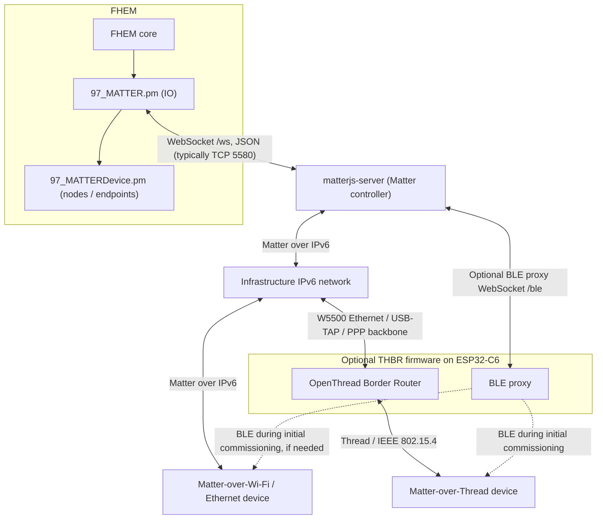

# FHEM Matter Integration (`MATTER` and `MATTERDevice`)

FHEM modules for controlling Matter devices through an **external Matter controller/server**. This repository is a fork of [Zeppelin's original FHEM Matter integration](https://gitlab.com/zeppelin1979/fhem-matter), with additional device synchronization, connection recovery, capability handling, commissioning options and FHEM updater support. The original work and its MIT license are retained; this fork is not an implementation of a Matter controller or Thread Border Router.

Two modules are installed:

- `FHEM/97_MATTER.pm`: the IO device that maintains the WebSocket/JSON connection to the controller and dispatches messages.
- `FHEM/97_MATTERDevice.pm`: logical FHEM devices representing a Matter node (root endpoint 0) and its individual endpoints.

## Architecture



The **Thread Border Router** routes IPv6 packets between the infrastructure network and the Thread mesh. The **BLE proxy** lends the ESP32-C6 Bluetooth radio to matterjs-server for initial commissioning. They are separate functions, even when running on the same board. After Thread commissioning, normal Matter communication goes through IPv6 and the Border Router, not BLE. FHEM only communicates with the Matter server.

The original [tostmann/THBR](https://github.com/tostmann/THBR) uses a host-based USB/TAP or PPP backbone. The [Flachzange/THBR-ETH fork](https://github.com/Flachzange/THBR-ETH) adds a standalone W5500 Ethernet/PoE backbone and retains the optional BLE proxy. Neither project is required for **Matter-over-Wi-Fi/Ethernet** devices that are already reachable from the Matter controller over IP. Other Thread Border Routers can provide the Thread route; this diagram illustrates the THBR deployments.

## Features

- **Connection recovery:** nonblocking IPv4 TCP/WebSocket connection; 10-second connect/upgrade deadline, Ping every 30 seconds, 15-second Pong deadline and retry 30 seconds after a failure.
- **Automatic node synchronization:** complete `start_listening` snapshot on connection/reconnection plus `node_added`, `node_updated` and `node_removed` events. Manual `discover` is still available; there is no periodic node polling.
- **FHEM device management:** optional `autocreate` (enabled by default), collision-safe root/endpoint identities, default room `Matter` for newly created devices, administrative root-node grouping, DeviceTypeList-based endpoint groups and links to endpoints in the root's FHEMWEB details. Existing names, rooms and custom groups are preserved; removed server nodes are marked rather than deleted.
- **Device commands:** exposed from the relevant Matter command/feature metadata when available, with legacy `has_*` fallback and explicit user overrides. Mappings include on/off, levels, colors, window covering and basic lock/unlock commands where supported.
- **Device status and measurements:** separate `matter_status` (server membership) and `available` (server-reported reachability), plus basic device information, power source/battery, smoke/CO and electrical power/energy readings when advertised and provided.
- **Commissioning:** manual pairing codes or `MT:` QR payloads, with `network` (IP-only, default) or `auto` (IP and optionally BLE via the Matter server).
- **Native FHEM updates:** a versioned `controls_matter.txt` published on this fork's `main` branch and validated by CI.

## Requirements and security

- A running FHEM installation with Perl's `JSON` module and network access to the external Matter server.
- A Matter server providing the specific **WebSocket/JSON API** used by these modules (including `start_listening`, node events and `device_command`). The primary integration here is [matter-js/matterjs-server](https://github.com/matter-js/matterjs-server), typically listening on port 5580. A generic Python/Node.js Matter controller is **not automatically compatible** just because it uses WebSockets.
- For Matter-over-Thread: a working Thread network, an IPv6 route from the Matter controller to its devices, and Thread credentials configured on the Matter server. To commission a factory-new device via BLE, the server must have working Bluetooth support, either locally or through a compatible BLE proxy. The THBR BLE proxy requires the server's proxy feature (for example `--ble-proxy` with matterjs-server).
- **Trusted-network requirement:** `97_MATTER.pm` uses an **unencrypted, unauthenticated `ws://` connection** to `/ws`. Neither transport encryption nor authentication is implemented by the FHEM module. Keep the server API on a trusted/controlled network; do not expose it directly to untrusted networks.
- **Sensitive commands:** `commissionCode` suppresses FHEM's synthetic `set` event and redacts pairing codes from module diagnostics, but the FHEM input/history may still contain the code. The existing `setWifiCredentials` command does **not** suppress that synthetic FHEM event; entering Wi-Fi passwords may expose them to FHEM event consumers/DbLog and sends them over the unencrypted WebSocket. Avoid using that command with sensitive production credentials until its handling is hardened. `getCredentials` returns the server's available credential metadata, not a mechanism for configuring a Thread dataset in FHEM.

## Installation and updates

Enter the following commands in the **FHEM command line**.

1. Inspect currently registered update sources:

   ```text
   update list
   ```

2. If Zeppelin's original source appears in the list, remove it before adding the fork; FHEM will not register another source with the same `controls_matter.txt` filename, and both sources install the same module paths:

   ```text
   update delete https://gitlab.com/zeppelin1979/fhem-matter/-/raw/main/controls_matter.txt
   ```

3. Add the fork's published `main` branch:

   ```text
   update add https://raw.githubusercontent.com/Flachzange/fhem-matter-fork/main/controls_matter.txt
   ```

4. Check what this source would update:

   ```text
   update check https://raw.githubusercontent.com/Flachzange/fhem-matter-fork/main/controls_matter.txt
   ```

5. Install/update **only the Matter modules**, without updating other FHEM sources:

   ```text
   update all https://raw.githubusercontent.com/Flachzange/fhem-matter-fork/main/controls_matter.txt
   ```

   Restart FHEM after a module update to reinitialize the IO connection, timers and logical devices:

   ```text
   shutdown restart
   ```

Only merged changes on `main` are published by this source. Adding it does not automatically schedule updates, and no copying of the Perl files is needed once this source is installed. `CHANGED` provides brief notes for the current branch release; [CHANGELOG.md](CHANGELOG.md) preserves the full fork history. FHEM's updater does not maintain a separate changelog baseline per update source, so the displayed notes are not necessarily the exact delta since your last installation.

### Testing branch (optional)

The [`testing` branch](https://github.com/Flachzange/fhem-matter-fork/tree/testing) contains changes that are being evaluated before they are merged into `main`. It provides its own [FHEM updater manifest](https://raw.githubusercontent.com/Flachzange/fhem-matter-fork/testing/controls_matter.txt). Use this branch only when you intentionally want to test newer development changes.

**Breaking change in testing V0.10 (endpoint DEF):** Old endpoint definitions containing a root FHEM name, such as `18 11 MATTER_MatterDevice_18`, are **not supported**. Before installing this version or restarting FHEM with it, convert existing endpoints while the previous module version is still loaded. Existing devices must have an explicit `IODev` attribute (autocreated endpoints already have one); correct any missing assignment before migration. In the **FHEM command line**, run this once to rewrite all MATTERDevice endpoint DEFs in place, preserving each device's name, FUUID, readings and attributes:

```text
{ join("\n", map { $_->{NAME}.": ".(fhem("modify ".$_->{NAME}." ".$_->{node_id}." ".$_->{endpoint_id}) || "OK") } grep { ($_->{TYPE}//"") eq "MATTERDevice" && ($_->{endpoint_id}//0) > 0 } values %defs) }
```

Then persist the modified definitions, **before updating**:

```text
save
```

Only proceed when the migration output reports no errors. Skipping this prerequisite can cause old endpoint definitions to fail during FHEM startup. Do not save a configuration in which endpoints failed to load. The new module intentionally does not automatically accept or convert the legacy syntax.

FHEM permits **only one update source named `controls_matter.txt`**. To switch an existing installation from this fork's `main` source to `testing`, enter the following commands in the **FHEM command line** (check your current sources with `update list` first):

```text
update delete https://raw.githubusercontent.com/Flachzange/fhem-matter-fork/main/controls_matter.txt
update add https://raw.githubusercontent.com/Flachzange/fhem-matter-fork/testing/controls_matter.txt
update check https://raw.githubusercontent.com/Flachzange/fhem-matter-fork/testing/controls_matter.txt
update all https://raw.githubusercontent.com/Flachzange/fhem-matter-fork/testing/controls_matter.txt
shutdown restart
```

To switch back to `main`, change the registered source and update the same modules from `main`:

```text
update delete https://raw.githubusercontent.com/Flachzange/fhem-matter-fork/testing/controls_matter.txt
update add https://raw.githubusercontent.com/Flachzange/fhem-matter-fork/main/controls_matter.txt
update check https://raw.githubusercontent.com/Flachzange/fhem-matter-fork/main/controls_matter.txt
update all https://raw.githubusercontent.com/Flachzange/fhem-matter-fork/main/controls_matter.txt
shutdown restart
```

Changing the registered source alone does **not** install or revert module files. The explicit `update all <source URL>` command downloads the selected branch's Matter modules; it does not update unrelated FHEM sources. Do not register the `main` and `testing` manifests simultaneously because they share the same filename and target module paths.

## Configuration and usage

### Matter IO device

Define an IO device with your Matter server's IPv4 address and its WebSocket port, using the FHEM syntax `define <name> MATTER <server-IPv4> <port>`. The example below uses a reserved documentation address; substitute the actual controller address:

```text
define matterServer MATTER 192.0.2.10 5580
```

Use `set matterServer connect` to reconnect manually if needed; otherwise recovery is automatic. `attr matterServer disable 1` closes the connection and cancels its timers; removing the attribute or setting it to `0` enables reconnection. Prefer a numeric IPv4 address because DNS lookup may block during connection establishment. The server connection state is displayed through `state` and `ws_status`.

### Commission devices

Commissioning is initiated on the **MATTER IO device**, not on an individual `MATTERDevice`. The following synthetic manual code demonstrates the syntax:

```text
set matterServer commissionCode 35325335079
set matterServer commissionCode 35325335079 network
set matterServer commissionCode 35325335079 auto
```

Without the `commissionMode` attribute, an omitted mode defaults to **`network`** (IP-only). Set `attr matterServer commissionMode auto` in the FHEM command line for persistent BLE/IP discovery. Explicit `network` and `auto` arguments override the attribute for that request; `auto` permits BLE (including a connected proxy) but does not force it. A Matter QR payload beginning with `MT:` can be used instead of an 11- or 21-digit manual code.

The Matter server handles commissioning, fabric and stored Thread/Wi-Fi network credentials. The FHEM module neither stores a Thread operational dataset nor operates the BLE radio.

The MATTER IO reports `commissioning_status` (`running`, `success`, `failed` or `interrupted`), `commissioning_mode`, `commissioning_node_id`, `commissioning_duration` (seconds) and `commissioning_error`. A new attempt clears old results; one attempt per IO is permitted at a time. These readings are independent of the server connection's `state`. The server does not expose intermediate BLE/PASE commissioning phases over WebSocket. `interrupted` means the connection was lost before the outcome was received: check server nodes before trying again.

### Node synchronization and status

Newly commissioned nodes are normally imported automatically. After a reconnect the complete `start_listening` result reconciles the server node list; a manual refresh is available:

```text
set matterServer discover
```

Root devices use `DEF = <node_id>` (for example `18`); endpoints use `DEF = <node_id> <endpoint_id>` (for example `18 11`). The `IODev` attribute selects the Matter server independently of the FHEM name; a root name is never part of an endpoint DEF. This allows root and endpoint devices to be renamed without changing the technical definition. New root and endpoint devices default to FHEM room `Matter` unless manually changed later. Root devices (endpoint 0) use the shared administrative group `Matter Nodes`; functional endpoints use the name of their **single non-structural** Matter `Descriptor.DeviceTypeList` device type (for example `On/Off light`, `Electrical Sensor` for `0x0510`, or `Smoke CO Alarm`). Although Matter classifies `Electrical Sensor` as a utility type, it represents a usable measurement endpoint. Endpoints with only structural types, including `Aggregator` and `Bridged Node`, use `Matter Infrastruktur` instead of retaining a technical node group. Structural companions such as Power Source and OTA Requestor do not create additional groups. Unknown device type IDs use hexadecimal labels; multiple distinct functional device types do not trigger an arbitrary choice. Automatically generated legacy groups in the exact format `Node <node_id> (<IODev>)` migrate to these groups; custom group values are not replaced. Existing physical room assignments are never changed during synchronization. `Smoke CO Alarm` is Matter's shared device type and does not imply that a CO-only detector also detects smoke. The root detail view links to existing endpoints and shows their Matter Descriptor device types when known, otherwise a conservative cluster-based description.

MATTERDevice leaves FHEM's initial `STATE` unchanged so FHEM can restore the last saved display state from its statefile on restart. This is independent of the server connection and does not create a synthetic reachability state.

`matter_status=present` / `removed` indicates membership in the server's node list, **not** physical availability. `available=true` / `false` indicates reachability only if reported by the server. Node-wide `model` and `available` values are mirrored from the root to endpoints when known. No recurring availability poll is introduced.

### Device commands and attributes

The available commands depend on the endpoint's reported clusters and commands. Examples include `on`, `off`, `toggle`, `brightness` (device level), `pct` (percentage where supported), `ct` (mired), `rgb` (hexadecimal), `stop`, `tilt`, `lock` and `unlock`. A command appearing in the list does not guarantee it will succeed on every device.

`set <MATTERDevice> getConfig` reads attributes from the **implemented Matter clusters**, the global capability metadata and the endpoint's DeviceTypeList. It is **not** a read of all possible attributes of every Matter cluster.

Supported MATTER IO attributes include `disable:0,1`, `autocreate:0,1` (default `1`) and `commissionMode:network,auto` (default `network`). Setting `autocreate` to `0` prevents newly discovered FHEM root/endpoint devices from being created; it does not delete Matter-server nodes or stop updates to existing FHEM devices. `commissionMode` affects subsequent `commissionCode` requests without an explicit mode.

MATTERDevice attributes include `IODev`, legacy capability overrides (for example `has_onoff`, `has_level`, `has_ct`, `has_wc` and `has_lock`) and level/color limits. If a command list has been reported, that server metadata takes precedence over legacy positive flags; a manually configured `has_*=0` disables the corresponding control.

## Known limitations

- **Window coverings:** supports basic open/close, stop, lift percentage and tilt commands when exposed by the device; not every WindowCovering-cluster function is mapped.
- **Door locks:** basic `lock`/`unlock` commands and selected readings are implemented; management of users, PINs and credentials is not implemented.
- **Thermostats:** device types can be displayed, but thermostat-control commands are not implemented.
- **Transport:** the FHEM IO supports an IPv4 WebSocket connection without built-in TLS or authentication; the network boundary and security requirements are described above.

## Development and tests

`prove -v t/matter_node_sync.t` runs modeled FHEM callback tests and WebSocket socketpair tests (including fragmented TCP delivery, large frames, node identity, capability handling, commissioning and endpoint synchronization). `.github/workflows/perl-tests.yml` runs those Perl tests in CI. The suite tests module behavior against simulated peers, not physical device behavior.

For module changes, run `bash make_controls.sh` and commit its updated `controls_matter.txt` alongside the changed Perl source. `bash make_controls.sh --check` and `.github/workflows/controls-matter.yml` verify the generated manifest. Its Git-blob sizes match the raw published files and its timestamps advance for changed modules, including same-size edits. Keep `CHANGED` to the current published notes and append historical changes to [CHANGELOG.md](CHANGELOG.md).

Follow [AGENTS.md](AGENTS.md) and [AGENTS-MATTER.md](AGENTS-MATTER.md) for documentation and release metadata maintenance. The existing MATTER IO `VERSION` internal identifies the module version; server/device firmware versions are separate. Changes on feature branches are not automatically published.

## License

[MIT License](LICENSE). The original project and copyright attribution are retained.
